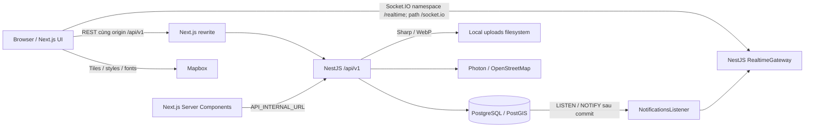

# WanderMap — Production Readiness Audit & Implementation Mốc A

## Kết luận hiện tại — sau implementation Mốc A, 27/10/2026

**Code prepared và locally verified; CHƯA kết luận READY FOR MILESTONE B.** Các P0 đã có implementation và bằng chứng local; real Cloudinary delivery, Render/Vercel topology và GitHub Actions vẫn chưa xác minh. P1-06 còn **PARTIALLY FIXED**. Không có residual risk nào được tự gán ACCEPTED RISK. Chỉ mở private deployment theo runbook sau review và CI xanh; cloud smoke tests là điều kiện trước khi mở audience.

Xem [MILESTONE_A_RESULTS.md](MILESTONE_A_RESULTS.md) để review dependencies, migration, security controls, kết quả test, đầy đủ files changed, environment variables và bước thủ công. Phần audit baseline bên dưới giữ nguyên các phát hiện/trạng thái lịch sử; bảng hiện tại này có hiệu lực cho implementation mới.

## Implementation ledger — 27/10/2026

Quyết định đã chốt: Cloudinary; authorization cho bytes media private; production DB trống, không chuyển development data; Node.js 22.23.4 security release. Baseline implementation `bed9a98` chỉ bổ sung báo cáo so với source đã audit. Không tạo cloud resources, truy cập production credentials, commit/push/merge hoặc chạy migration trên DB hiện có.

| Package | Issues | Trạng thái implementation và bằng chứng |
| --- | --- | --- |
| A1 | P0-02, P1-01 | **FIXED & VERIFIED (local/Linux)**: Next/eslint-config-next 15.5.28, Sharp frontend 0.35.5, Zod 4.6.7 + resolver 5.9.2; scoped overrides body-parser 2.4.0, Multer 2.5.0, js-yaml 5.5.0, fast-uri 3.1.9, Next PostCSS 8.5.30 và selector parser 6.1.5. Full và production-only audit cả hai app: 0 advisories. Clean npm ci/build trên Node 22.23.4 Linux đạt; native Next optimizer/Sharp và Vietnamese schema/resolver tests đạt. Cloud runtime vẫn NOT VERIFIED. |
| A2 | P1-02, P1-03, P1-06 | **P1-02 FIXED & VERIFIED; P1-03 FIXED, NOT VERIFIED IN CLOUD; P1-06 PARTIALLY FIXED**. Blank defaults, exact HTTPS origins, secret-safe validation, no production localhost fallbacks, same-origin REST enforcement, explicit trusted CIDRs và TLS verification. Env/proxy/cookie tests đạt. pg Client transport tests xác nhận URL sslmode không ghi đè certificate verification, áp dụng cho pool/LISTEN/migrations. Render forwarding topology, TLS endpoint và Vercel cookies vẫn cần cloud verification. |
| A3 | P0-01, P1-04, P1-09 | **FIXED, NOT VERIFIED IN CLOUD**. `media_assets`/ownership triggers (016), authenticated Cloudinary SDK 2.11.0, local private provider, per-request/rechecked resource authorization, no-store delivery và 18 consumers ảnh được triển khai; không lộ provider URLs. 12 upload/storage unit tests, 5 HTTP/PostGIS media security tests trên disposable DB và 143 frontend tests đạt. Real Cloudinary upload/delivery, unsigned URL rejection trên account thật và Vercel caching vẫn NOT VERIFIED. Xem MEDIA_SECURITY.md; legacy development URLs không được tự migrate hoặc mô tả là private. |
| A4 | P1-05, P1-08 | **FIXED & VERIFIED cho production DB trống**. Migration 015 sửa unaccent, refresh STORED search values, giữ timestamps/coordinates/trigger mode và indexes; 3 integration tests nâng cấp schema có dữ liệu đạt. Manifest Git-baseline đóng gói verified canonical copies vào dist, không viết lại 001–014 hoặc DB history; tests chặn SQL drift. Compiled runner áp dụng đủ 16 migrations trên DB test mới, lần hai no-op, status 0 pending. Toàn bộ 9 DB suites/156 tests không skip đạt. DB development CRLF tiếp tục dùng source runner; không dùng canonical production artifact để né checksum trên DB cũ. |
| A5 | P1-07, P2-01 | **FIXED, NOT VERIFIED IN CLOUD; GITHUB CI NOT RUN**. Một workflow Next/Nest thay Deno, Node 22.23.4, npm ci, audits, frontend tests/build và PostGIS service; CI từ chối missing/skipped DB tests. Mirror Linux cuối: frontend 143 tests/lint 0 warnings/type-check/build; backend 163 unit + 3 transport + 156 DB tests không skip, health e2e/type-check/lint/build đạt. Final production image non-root, đúng Node 22.23.4/16 SQL artifacts, compiled API/real DB/authenticated socket/SIGTERM đạt. GitHub Actions chưa được trigger/push trong Mốc A. |
| A6 | P2-02 đến P2-06 | **FIXED, NOT VERIFIED IN CLOUD**. Swagger production default off/persistAuthorization false; LOG_LEVEL validate/apply, redact raw errors; lint warnings đã sửa; README và deployment/env/smoke/rollback/media-security docs đã thêm/cập nhật; Photon example HTTPS. Real cloud behavior và full browser matrix vẫn cần Mốc B. |

| Phát hiện bổ sung trong implementation | P1-10, P1-11 | P1-10 **FIXED & VERIFIED**: auth forms khai báo method POST để native fallback trước hydration không đưa password lên query string; regression Chrome xác nhận form POST và login thực tế. P1-11 **FIXED, NOT VERIFIED IN CLOUD**: shared pg connection policy loại URL SSL overrides và luôn verified TLS production; 3 transport tests dùng pg Client thật đạt trên Linux Node 22.23.4. |

Không còn issue được để **OPEN/BLOCKED** trong phần implementation local; các release gates chưa hoàn tất được ghi rõ PARTIALLY FIXED hoặc NOT VERIFIED. Điều này không đóng cloud gates hay chứng minh toàn bộ UX Phase 1–4.

Runtime pin là security release [Node.js 22.23.4, 21/10/2026](https://nodejs.org/en/blog/release/v22.23.4). Host Windows vẫn là 22.21.1; không thay global runtime. Bằng chứng runtime đích lấy từ official Linux image 22.23.4.

---

## Audit baseline (trước implementation)

- Ngày audit: **27/10/2026**, múi giờ Asia/Saigon.
- Baseline: commit **`5c5bbf0`**, `Merge pull request #7 from duynk02/feature/phase-4-messaging`; working tree sạch khi bắt đầu.
- Mục tiêu: Next.js trên Vercel, NestJS trên một Render Web Service, managed PostgreSQL/PostGIS và persistent media storage.
- Phạm vi lượt này: **audit, kiểm tra baseline và lập kế hoạch**. Chỉ thêm báo cáo này; chưa sửa source, dependency, cấu hình, workflow hoặc migration. Build chỉ tạo/cập nhật output được Git ignore.
- Chưa tạo tài nguyên cloud, deploy, push/merge, chạy migration hoặc đọc/ghi dữ liệu database ứng dụng. Không đưa giá trị secrets vào báo cáo.

## 1. Executive Summary — Current Readiness Status

**Verdict: NOT READY cho Mốc B.** Hai ứng dụng build được trong môi trường local hiện có, nhưng còn **2 P0, 9 P1 và 6 P2**. Mọi phát hiện đều chưa được khắc phục trong lượt audit.

Hai P0 là ảnh đang lưu trên filesystem backend, không phù hợp Render mặc định, và dependency frontend có advisory critical liên quan Next.js/Sharp. Ngoài ra có lỗi SQL tìm kiếm, env mẫu không khởi động được nếu chỉ điền JWT, CI không kiểm tra stack thực tế, cùng các khoảng trống production cần giải quyết bên dưới.

| Hạng mục | Kết quả audit |
| --- | --- |
| Frontend type-check / lint / production build | **PASS**; lint có 6 warnings |
| Backend type-check / lint / production build | **PASS** |
| Backend unit tests | **PASS: 10 suites, 144 tests** |
| Frontend Node tests | **PASS: 17 files, 136 tests** |
| Health e2e | **PASS: 1 test**, database được mock |
| Dependency audit toàn bộ | Frontend: **1 critical, 3 high, 1 moderate**; backend: **3 high, 3 moderate** |
| Dependency audit `--omit=dev` | Frontend: **1 critical, 3 high**; backend: **3 high, 2 moderate** |
| Build từ clean install / Linux / cloud | **NOT VERIFIED**; baseline dùng dependencies local có sẵn |
| PostgreSQL/PostGIS thật, migrations trên database rỗng và dữ liệu có sẵn | **NOT VERIFIED**; không có `WANDERMAP_TEST_DATABASE_URL` trong môi trường shell |
| Vercel rewrite + cookies, Render Socket.IO, cloud upload | **NOT VERIFIED**, chưa có môi trường cloud được kiểm tra |
| Persistent media | **BLOCKED** bởi P0-01 |

`npm audit` đếm các package bị ảnh hưởng, gồm cả package cha và dependency con; các số trên **không phải số đường khai thác độc lập**. Bản audit phân biệt lỗi xác nhận từ mã nguồn, advisory khớp phiên bản và hành vi cloud chưa kiểm chứng. Không có tuyên bố đã khai thác được ứng dụng.

## 2. Current Architecture — Kiến trúc đã đối chiếu mã nguồn

| Thành phần | Trạng thái thực tế và bằng chứng |
| --- | --- |
| Repository | Hai ứng dụng độc lập; không có root `package.json`. Có lockfile v3 ở cả hai app. Không có `frontend/README.md`. |
| Frontend | Next.js **15.5.27**, React **19.3.0**, TypeScript **5.9.3**, Mapbox GL **3.32.0**, Socket.IO client **4.8.4** theo lockfile và `npm ls --depth=0`. |
| Backend | NestJS **11.2.7**, Socket.IO **4.8.4**, `pg` **8.23.1**, Sharp **0.35.5**; modular monolith, raw parameterized SQL. |
| Chức năng Phase 1–4 | Có profile editing/avatar crop, visited locations, travel map, Journey Builder/detail/export/share, realtime notifications, direct messaging, read receipts, mutual-follow/block policy và share Post/Location/Journey. Bằng chứng: `backend/src/app.module.ts:17`, `backend/src/messaging/`, `backend/src/journeys/`, `frontend/src/components/journey/`, `frontend/src/components/messaging/`. Có implementation không đồng nghĩa đã xác minh trên production. |
| Routes | Production build liệt kê `/feed`, `/explore`, `/journey/[id]`, `/messages/[[...conversation]]`, profile, posts, locations và auth. `/` redirect về feed; không có frontend itinerary page hoàn thiện được xác nhận trong audit. |
| Auth | JWT memory-only; refresh là chuỗi random lưu hash trong `auth_sessions`, không phải JWT. Có rotation, replay detection, shared refresh promise, Web Locks và BroadcastChannel lifecycle signals. **Không cần `JWT_REFRESH_SECRET`** trong kiến trúc hiện tại. |
| Database | Có **14 migrations, 001–014**, gồm Journey, notifications realtime và messaging; extensions `postgis`, `unaccent`, `pg_trgm`; geometry SRID 4326, GiST và GIN indexes. |
| Upload | `POST /uploads/images` yêu cầu JWT; memory upload tối đa 10 MiB, kiểm tra bytes bằng Sharp, resize 2048 px, pixel limit, loại metadata, chuyển WebP, tên theo content hash. Ghi local disk và phục vụ public `/uploads`. |
| Media thực sự có | Avatar, ảnh bài, Journey cover và poster chia sẻ qua cùng upload wrapper. Chưa có profile cover upload hoặc chat image attachment; chat hiện chia sẻ resource, không có message type ảnh tự do (`messaging.dto.ts:5`). |
| Export Journey | Tạo Mapbox canvas và PNG **trong browser**; dynamic import Mapbox, chờ fonts, `preserveDrawingBuffer`, attribution, cancellation và cleanup. Chỉ upload khi chia sẻ poster. |
| Deployment hiện có | Có backend multi-stage Dockerfile, non-root runtime, compiled start/migration scripts. Workflow duy nhất là Deno, không kiểm tra Next/Nest. Không có Render/Vercel deployment manifest trong cây file audit. |

Không suy ra tài nguyên cloud hay dữ liệu production đã tồn tại từ các README hoặc placeholder. Không audit trực tiếp tài khoản Vercel, Render, Mapbox hoặc storage provider.

## 3. Target Architecture — Phương án đề xuất để review

1. **REST:** giữ browser gọi `/api/v1` trên Vercel; external rewrite sang `https://YOUR-API.onrender.com/api/v1`. SSR cũng dùng URL HTTPS công khai này qua `API_INTERNAL_URL`; Vercel không truy cập hostname private của Render.
2. **Refresh cookie:** host-only trên host frontend thông qua response rewrite; giữ `HttpOnly`, `Secure`, `SameSite=Lax`, `Path=/api/v1/auth`, không đặt `Domain` của Render. Cần xác nhận hành vi `Set-Cookie` bằng browser ở Mốc B.
3. **Socket.IO:** browser kết nối thẳng `https://YOUR-API.onrender.com`; namespace **`/realtime`**, Engine.IO HTTP path **`/socket.io`**. Xác thực bằng JWT từ memory; không cần refresh cookie được gửi sang Render.
4. **Backend:** một instance, một Node process; giữ rooms trong memory. Chưa thêm Redis. Không dùng PM2 cluster hay autoscale nhiều instance cho bản đầu.
5. **Database:** ưu tiên PostgreSQL **16** để gần local baseline; xác minh phiên bản PostGIS thật, extension permissions, connection budget và backup. Có thể dùng private network cùng region; TLS phải chọn theo endpoint thực tế, không mặc định tắt certificate verification.
6. **Media:** đề xuất **Cloudinary** sau lớp storage nhỏ trong module uploads, giữ Sharp và response `{ url, width, height, bytes }`. Chốt chính sách ảnh private trước khi quyết định delivery public hay authenticated. Giữ local provider cho development.

Render công bố hỗ trợ PostGIS, unaccent và pg_trgm cho các PostgreSQL version phù hợp; extension vẫn phải được enable bằng `CREATE EXTENSION`. Render hỗ trợ WebSocket và mặc định dùng ephemeral filesystem. Đây là tính năng của nền tảng, chưa phải kết quả kiểm thử WanderMap trên cloud. [Render extensions](https://render.com/docs/postgresql-extensions), [Render WebSocket](https://render.com/docs/websocket), [Render disks](https://render.com/docs/disks).

## 4. Deployment Blockers — P0

### P0-01 — Media mất khả năng tồn tại sau restart/redeploy trên Render mặc định

- **Bằng chứng:** `backend/src/uploads/uploads.service.ts:26` chọn local `rootDir`; dòng 54–59 ghi file. `backend/src/main.ts:53` phục vụ public static assets. `backend/Dockerfile:15` chỉ khai báo volume, không tự provision Render persistent disk. Chưa có Cloudinary/S3 runtime integration.
- **Ảnh hưởng:** database vẫn giữ URL nhưng file biến mất khi filesystem được thay; avatar, bài đăng, Journey cover/poster sẽ lỗi. Phạm vi P0 là phương án Render không gắn storage bền vững đã được yêu cầu.
- **Giải pháp dự kiến:** thêm storage interface và Cloudinary provider; giữ kiểm tra bytes/Sharp, chuyển buffer đã xử lý lên provider, trả URL HTTPS. Local chỉ dùng development hoặc giai đoạn giữ ảnh cũ có kế hoạch. Render disk có thể là lựa chọn tạm nếu được chọn riêng, nhưng không đáp ứng mục tiêu cloud media một cách tự động.
- **Bảo toàn dữ liệu:** kiểm kê file và URL hiện hữu trước; backup, lập mapping old URL → asset mới, verify checksum/khả năng đọc, chuyển URL có kiểm soát và giữ bản cũ cho rollback. Không bulk replace hostname hoặc xóa file cũ.
- **Trạng thái:** **OPEN — chưa thay code/provider; cloud credentials và dữ liệu media chưa được kiểm tra.**

### P0-02 — Frontend khóa phiên bản thuộc advisory critical của Next.js/Sharp

- **Bằng chứng:** `frontend/package-lock.json` khóa `next@15.5.27`, `sharp@0.33.5`; `npm audit --json` và `--omit=dev` đều báo Next mức critical. `frontend/package.json:13`, `:40` khai báo Next 15 và Sharp 0.33. `frontend/next.config.ts:10` có Image Optimization; `PostCard.tsx:91` vẫn dùng optimizer cho một số URL.
- **Advisory:** [GHSA-2464-fhr4-w9xw](https://github.com/advisories/GHSA-2464-fhr4-w9xw) mô tả nguy cơ RCE ở image processing trên Linux glibc với SVG; upstream liệt kê Next **15.5.28** và Sharp **>=0.35.5** là các mốc khắc phục liên quan. Các advisory Sharp khác cũng xuất hiện trong audit frontend.
- **Ảnh hưởng:** phải giải quyết hoặc hoàn tất triage có bằng chứng trước public release. **Đã xác nhận dependency nằm trong affected range; chưa chứng minh đường khai thác trong cấu hình Vercel của ứng dụng.** Nhiều component bypass optimizer và API upload từ chối SVG; các điều đó không tự chứng minh toàn bộ frontend image endpoint an toàn.
- **Giải pháp dự kiến:** nâng Next lên patch 15.x đã sửa, đồng bộ eslint-config-next khi phù hợp; đánh giá nâng Sharp frontend từ 0.33 lên ít nhất bản đã sửa. Với Sharp trước 1.0, đổi minor có thể là thay đổi không tương thích; phải review và kiểm tra native Linux binary/image optimizer. Cập nhật lockfile có chủ đích, xác nhận Sharp mà Next thực sự resolve, chạy lại audits/builds/tests. Không cần nâng Next 16/React major theo mặc định.
- **Trạng thái:** **OPEN — chưa thay dependency; chặn public release cho tới khi được xử lý/triage thỏa đáng.**

## 5. Security Risks và Configuration Gaps — P1

### P1-01 — Các advisory runtime/build khác chưa được xử lý

- **Bằng chứng:** backend lockfile có `body-parser@2.3.0`, `multer@2.4.0`, `js-yaml@5.3.0`; frontend có `zod@3.25.76`, `next/node_modules/postcss@8.4.31`. Audit production vẫn báo các package này và package cha bị ảnh hưởng. Chi tiết ở mục 10.
- **Ảnh hưởng:** advisory body-parser mô tả request compressed bất thường có thể làm process thoát trước routing/auth; ảnh hưởng availability của backend một instance. Multer advisory yêu cầu asynchronous `fileFilter`; controller hiện không khai báo filter này, vì vậy không kết luận route hiện tại đã thỏa điều kiện khai thác. Zod đang dùng phía frontend; mức độ ảnh hưởng đến server chưa được chứng minh. PostCSS cần phân biệt xử lý CSS do developer kiểm soát với input do attacker kiểm soát.
- **Giải pháp dự kiến:** cập nhật dependency tree tương thích để lấy body-parser >=2.4.0 và Multer >=2.5.0 hoặc bản sửa tương ứng; kiểm tra chain Nest/Express trước khi dùng override. Triage js-yaml/PostCSS/Zod theo call sites. Zod 4 là major và liên quan resolver/forms; lập thay đổi riêng nếu không có backport phù hợp. Không chạy `npm audit fix --force`.
- **Trạng thái:** **OPEN — advisory khớp lockfile; chưa chạy exploit, chưa nâng phiên bản.** [body-parser advisory](https://github.com/advisories/GHSA-27r3-jxmh-p828), [Multer advisory](https://github.com/advisories/GHSA-q7qp-rjg7-q26m), [Zod advisory](https://github.com/advisories/GHSA-mrhx-c7xc-m3w5).

### P1-02 — Backend env mẫu chứa giá trị rỗng làm validation thất bại

- **Bằng chứng:** `backend/.env.example:7`–`:14` để rỗng `DB_POOL_MAX`, token TTL, refresh days và SameSite. `validate-env.ts:4`–`:11` chỉ dùng `??`; `Number('')` thành 0 và `''` không nhận default. Đã parse env mẫu, chỉ thay JWT bằng fixture đủ dài, rồi gọi validator compiled: lỗi đúng bốn biến trên.
- **Ảnh hưởng:** hướng dẫn copy env và chỉ điền JWT không đủ để backend chạy. `DATABASE_URL` mẫu dùng user `wandermap-onlydev` trong khi Compose dùng `wandermap` (`docker-compose.yml:8`); copy nguyên mẫu còn có thể sai credentials local.
- **Giải pháp dự kiến:** đưa default an toàn và nhất quán vào env mẫu; xử lý blank cho optional values có default, vẫn fail fast với biến bắt buộc. Đồng bộ hướng dẫn Compose/user/password. Thêm regression test validator tương ứng.
- **Trạng thái:** **OPEN — đã tái hiện bằng fixture; không đọc secrets hoặc kết nối DB.**

### P1-03 — Production thiếu fail-fast cho API/realtime/media URLs và origin allowlist

- **Bằng chứng:** `frontend/next.config.ts:6`, `frontend/src/lib/api/client.ts:59`, `frontend/src/hooks/useRealtimeConnection.ts:22` fallback localhost nếu thiếu env. `UploadsService:29` sinh URL HTTP localhost nếu thiếu public URL. `validate-env.ts:22` chỉ kiểm tra prefix database URL; `:27`–`:28` kiểm tra URL sơ bộ; `CORS_ORIGINS` default localhost và không validate origin/HTTPS. `PGSSLMODE` đang dùng nhưng thiếu env mẫu.
- **Ảnh hưởng:** vẫn build/start được dù production trỏ nhầm localhost, dùng mixed content hoặc không cho origin frontend thật. Đây là khoảng trống cấu hình được xác nhận; chưa kết luận production env thực tế đang sai.
- **Giải pháp dự kiến:** validate URL bằng parser, không có credentials trong public URLs, yêu cầu HTTPS và origin chính xác ở production; fail build khi thiếu API/realtime/Mapbox cần thiết. Giữ fallback local cho development. Khi chọn cloud storage, production phải có đủ config provider. Không thêm tên biến đồng nghĩa như FRONTEND_URL khi `CORS_ORIGINS` đã đáp ứng.
- **Trạng thái:** **OPEN — chưa sửa validation; cấu hình cloud thực tế NOT VERIFIED.**

### P1-04 — Post grid chưa tương thích URL media từ cloud provider mới

- **Bằng chứng:** `frontend/next.config.ts:11` chỉ allow Supabase public storage, Google avatars và DiceBear. `frontend/src/components/post/PostCard.tsx:28` bypass optimizer cho local `/uploads/<shard>/<hash>.webp` hoặc DiceBear; dòng 91 dùng Next Image cho post grid. Cloudinary/S3 URL không thuộc hai nhóm trên. Backend DTO chấp nhận HTTP/HTTPS URLs, không chỉ ba hostname được allow.
- **Ảnh hưởng:** chuyển upload sang Cloudinary nhưng giữ nguyên frontend sẽ làm nhánh post grid gọi optimizer với hostname không được cho phép. Feed/detail dùng `` nên không thể lấy việc feed hiển thị để kết luận toàn bộ ảnh hoạt động.
- **Giải pháp dự kiến:** định nghĩa policy ảnh tập trung, allow đúng cloud hostname/account/path hoặc bypass optimizer có chủ đích cho ảnh đã sanitize. Giữ URL legacy cần dùng; không mở wildcard mọi hostname. Kiểm tra cả grid, avatar, feed, detail, share cards và Journey.
- **Trạng thái:** **OPEN — incompatibility được suy ra trực tiếp từ cấu hình hiện tại khi dùng target provider; chưa tích hợp cloud để tái hiện browser.**

### P1-05 — SQL `vn_normalize()` bỏ qua tham số, làm sai search index

- **Bằng chứng:** `backend/src/database/migrations/002_accent_insensitive_search.sql:9` gọi `public.unaccent('public.unaccent(input)')`: đối số là **string literal**, không phải biến `input`. Dòng 11–17 tạo generated stored column từ hàm đó. `backend/src/locations/locations.service.ts:49`–`:68` dùng `search_text` cho ILIKE/trigram ranking.
- **Ảnh hưởng:** trên schema áp dụng đúng SQL trong repository, các giá trị input không-null cho cùng một chuỗi chuẩn hóa cố định; tìm tên/city/address không cho kết quả đúng. Generated values đã lưu không tự tính lại chỉ vì thay thân hàm. Đây là lỗi đã xác nhận bằng đọc biểu thức SQL; chưa truy vấn database đang dùng để xác nhận function definition có drift hay không.
- **Giải pháp dự kiến:** tạo migration **`015_fix_location_search_normalization.sql`** nếu 015 còn trống khi triển khai; sửa hàm theo unaccent và đ/Đ đúng, lập bước tính lại generated values và xác minh GIN index. Đánh giá locks, thời gian backfill và ảnh hưởng timestamps trên dữ liệu lớn trước khi chốt SQL. Test tìm có/không dấu và so sánh nhiều input khác nhau trên DB riêng. **Không sửa migration 002 đã áp dụng.**
- **Trạng thái:** **OPEN — chỉ đề xuất migration mới, chưa tạo/chạy migration.**

### P1-06 — Chưa có policy nhận diện client IP qua chuỗi proxy Vercel–Render

- **Bằng chứng:** `backend/src/main.ts` không cấu hình Express `trust proxy`; `app.module.ts:24`/`:40` dùng ThrottlerGuard toàn cục, login/register giới hạn 5/phút (`auth.controller.ts:19`, `:30`). Metadata auth lấy `request.ip` (`:70`). Không có custom tracker cho HTTP global guard; messaging có thêm sender-based guard riêng.
- **Ảnh hưởng:** qua reverse proxy, IP mà Express dùng có thể là IP proxy; throttling và audit metadata có thể không phân biệt người dùng. Chưa đo forwarding chain thật trên Render nên không khẳng định số hop hay hành vi 429 đã xảy ra.
- **Giải pháp dự kiến:** xác minh topology và headers ở môi trường private; cấu hình trust boundary/tracker đúng các hop/proxy tin cậy, giữ hạn chế brute force. Test hai client/IP và headers giả mạo, cả truy cập Render trực tiếp lẫn qua Vercel. Không mặc định `trust proxy=true` hay tin mọi X-Forwarded-For.
- **Trạng thái:** **OPEN — code gap xác nhận, tác động cloud NOT VERIFIED.**

### P1-07 — CI hiện không kiểm tra Next.js/NestJS

- **Bằng chứng:** workflow duy nhất `.github/workflows/deno.yml:28`–`:42` cài Deno rồi chạy `deno lint`/`deno test -A`; không có npm ci, app working directories, Next/Nest build/type-check/tests hoặc PostGIS service.
- **Ảnh hưởng:** PR có thể được merge mà không có bằng chứng các app build được; workflow Deno không phải quality gate cho stack hiện tại.
- **Giải pháp dự kiến:** sửa/thay workflow này bằng jobs frontend/backend, Node version thống nhất, npm ci theo lockfile, lint/type-check/build/unit tests và health e2e. Thêm PostGIS service riêng cho DB suites, fail nếu suite yêu cầu lại bị skip; không dùng production secrets. Frontend tests có thật nhưng chưa có npm test script: thêm script chạy Node tests hiện có, không khai báo bước giả.
- **Trạng thái:** **OPEN — chưa sửa workflow hoặc cài thêm test framework.**

### P1-08 — Checksum migration có nguy cơ khác giữa checkout Windows và Linux

- **Bằng chứng:** `git ls-files --eol` cho thấy **002, 003, 004, 005, 011** là `i/lf` nhưng `w/crlf`, chưa có `eol=lf` attribute riêng. `.gitattributes` chỉ pin một phần các migration. Runner `migrate.ts:37`–`:41` hash raw SQL bytes và dừng khi checksum khác.
- **Ảnh hưởng:** database đã migrate từ bytes CRLF có thể từ chối migration status/start release tooling khi artifact Linux chứa LF. Không gây vấn đề này với DB hoàn toàn mới được tạo và sử dụng cùng một canonical artifact. Chưa đọc `schema_migrations` thật nên không kết luận database hiện hữu đã mismatch.
- **Giải pháp dự kiến:** inventory checksums trên DB được phép và artifact dự định deploy; giữ nguyên bytes migration đã áp dụng. Chỉ chốt `.gitattributes`/artifact strategy sau đối chiếu lịch sử; không tự normalize tất cả file, sửa recorded checksums hoặc bỏ checksum validation. Kiểm tra cả fresh DB và đường nâng cấp từ backup riêng.
- **Trạng thái:** **OPEN — khác line endings đã xác nhận; tương thích DB thật NOT VERIFIED.**

### P1-09 — URL media public không kế thừa visibility của Post/Journey

- **Bằng chứng:** `main.ts:53` mount static `/uploads` không có auth/ownership check, cache public file dài hạn; `uploads.service.ts:63` trả public URL. Post có `private/followers`, Journey có `private`, nhưng media bytes được phục vụ độc lập. Endpoint upload không nhận quan hệ resource/visibility.
- **Ảnh hưởng:** người có URL vẫn có thể đọc ảnh từ bài/Journey private hoặc sau khi đổi visibility; hash khó đoán không thay thế authorization. Đây là hành vi thiết kế đã xác nhận, không phải bằng chứng URL private đã bị lộ. Không có chat attachment tự do để suy ra rò rỉ loại media chưa triển khai.
- **Giải pháp dự kiến:** chốt yêu cầu sản phẩm cho media private. Nếu cần bảo mật bytes, dùng authenticated delivery/authorization và mapping asset–owner–resource; không lưu signed URL ngắn hạn như URL cố định trong DB. Phải thiết kế revoke/cache/legacy migration; public Cloudinary URL đơn thuần không sửa được vấn đề này.
- **Trạng thái:** **OPEN — cần quyết định chính sách trước implementation storage.** Nếu yêu cầu bắt buộc là giữ kín bytes ảnh private, đây trở thành release gate bắt buộc của storage; không tự tuyên bố public provider đáp ứng yêu cầu đó.

## 6. Recommended Changes — P2

| ID / mức độ | Vấn đề và bằng chứng | Ảnh hưởng | Thay đổi dự kiến | Trạng thái |
| --- | --- | --- | --- | --- |
| P2-01 | Node backend chỉ `>=20.19`, frontend thiếu engines; Docker `node:22-alpine` dùng `npm install` (`Dockerfile:1`–`:6`); không có version file chung. | Native build/runtime có thể khác local; cài dependency Docker chưa dùng chế độ frozen-lock rõ ràng. | Chọn Node 22 đã cập nhật bảo mật và tương thích baseline, đặt giới hạn major nhất quán Vercel/Render/CI; dùng npm ci trong Docker. Kiểm tra clean Linux install và Sharp. | OPEN |
| P2-02 | Swagger `/docs`, `/docs-json` luôn bật và `persistAuthorization: true` (`main.ts:76`–`:83`). | Tăng bề mặt tài liệu public; token nhập thủ công trong Swagger có thể được Swagger persist. Không có bằng chứng credentials đang bị lộ. | Chọn disable/protect production docs, tắt persistAuthorization khi cần; giữ Swagger ở development. | OPEN |
| P2-03 | `LOG_LEVEL` có trong env mẫu nhưng không được đọc; startup in localhost, upload rejection dùng debug (`main.ts:87`, `uploads.service.ts:48`). | Khó cấu hình log phù hợp production và dễ hiểu nhầm URL; chưa xác nhận log có secret hoặc nội dung chat. | Validate/apply log levels; log startup/error có request ID và redact dữ liệu nhạy cảm. Không thêm monitoring framework lớn. | OPEN |
| P2-04 | Frontend lint có 6 warnings: ARIA và `` tại `MapTopbar.tsx:128`, `:351`; unused tại `PostFeedClient.tsx:20`; any tại `useDebounce.ts:4` và `lib/mapbox/index.ts:70`. | Nợ accessibility/type/performance; không làm build thất bại. | Sửa warning có ý nghĩa; dùng combobox role/pattern đúng nếu giữ aria-expanded, types cụ thể; giữ lựa chọn ảnh phù hợp storage thay vì đổi toàn bộ UI. | OPEN |
| P2-05 | README còn mô tả Phase 2/3 là bước sau, scripts root không tồn tại, `/auth/me` và upload trạng thái cũ (`README.md:30`, `backend/README.md:98`, `:139`, `:255`). Frontend ignore thiếu `.env.production`/`.env.development` và Cloudinary placeholders ở frontend dù provider cần server credentials. | Dễ cấu hình/triển khai nhầm; không xác nhận có secret trong tracked env. | Cập nhật tài liệu theo source, bổ sung bốn deployment docs còn lại sau review, cải thiện ignore patterns và chuyển hướng dẫn credentials về backend. | OPEN |
| P2-06 | `backend/.env.example:21` dùng Photon HTTP, trong khi default service là HTTPS; sample đã cảnh báo public Photon fair-use. `places.service.ts` có timeout, bounded cache và fallback. | Search ngoài có thể không ổn định hoặc gửi query không mã hóa nếu dùng nguyên env mẫu; dữ liệu local vẫn có fallback. | Dùng HTTPS, xác minh usage policy và ngân sách provider trước mở rộng; không tự dựng thêm dịch vụ trong lượt này. | OPEN |

## 7. Authentication, Cookies, CORS và Realtime

### Những bất biến đang có và nên giữ

- `client.ts:63`–`:149`: access token trong memory; shared refresh promise, timeout; 401 retry có giới hạn và kiểm tra session/version. `authStore.ts:28`–`:32` chỉ persist profile.
- `client.ts:35` và auth transition: Web Locks serialize cookie writes giữa tabs nếu browser hỗ trợ; BroadcastChannel chỉ gửi lifecycle signals, không token. Trường hợp browser thiếu Web Locks vẫn cần test thực tế; chưa coi unit tests là xác minh mọi trình duyệt.
- `auth.service.ts:66`–`:103`: refresh lock row trong transaction, random token mới, hash SHA-256; reuse có thể revoke sessions. Logout revoke refresh session; access JWT đã phát hành hết hạn theo TTL, không có instant token blacklist. Không gọi đó là bug riêng khi chưa có yêu cầu thu hồi tức thời.
- Cookie set/clear dùng cùng options (`auth.controller.ts:82`–`:89`): HttpOnly, Secure bắt buộc khi production, SameSite cấu hình, path `/api/v1/auth`, có expiry, không Domain. `GET /users/me` là endpoint frontend dùng; `/auth/me` đang comment.
- REST CORS allowlist cụ thể, credentials, OPTIONS và request ID headers; auth có Origin check riêng. Socket adapter kiểm tra Origin cho cả handshake/upgrade; không có wildcard với credentials. Cần đưa origin Vercel thật vào allowlist dù REST dùng rewrite, vì auth Origin check và socket vẫn áp dụng.
- Gateway JWT middleware chạy trước connection; room lấy từ `user.sub` đã verify, không có client join-room; kiểm tra user active/expiry và cleanup timers. Private event được gửi sau commit và kiểm tra recipient (`realtime.gateway.ts:36`–`:119`).
- Messaging controller bắt buộc JWT; sender lấy từ current user, DTO không có sender override; service check membership và SQL participant filters (`messaging.service.ts:114`, `:127`, `:187`). Có idempotency, mutual follow/block, resource-access projection và private/no-store headers. Chưa phát hiện lỗi cho phép đọc conversation người khác từ đường code đã audit; **DB/browser security integration chưa chạy lại**.

### Cookie qua rewrite — điều kiện cần kiểm chứng

| Bước | Hành vi thiết kế |
| --- | --- |
| Login/register | Browser POST tới `https://YOUR-APP.vercel.app/api/v1/auth/...`; Vercel forward đến Render. |
| Set-Cookie | Nếu header được forward nguyên nghĩa và không có Domain, browser gắn cookie cho host Vercel của request. Backend không tự chuyển cookie sang host Render. |
| Refresh/logout | Browser gửi cookie theo path `/api/v1/auth`, credentials include; rewrite forward Cookie đến backend. Logout clear đúng host/path vì cùng origin endpoint và cookie options. |
| Socket.IO | Đi thẳng Render với `auth.token`; không dùng refresh cookie host Vercel để xác thực socket. |
| Chuyển custom domain | Cookie host-only không tự chuyển từ `vercel.app` sang domain mới; dự kiến đăng nhập lại và cập nhật allowlist/token restrictions. |

Không đổi toàn bộ sang `SameSite=None`. Nếu REST chuyển sang Render trực tiếp, hai domain khác site đòi hỏi thiết kế cookie/CSRF khác và chịu browser third-party-cookie restrictions. Phương án đề xuất vẫn giữ REST same-origin. Vercel hỗ trợ proxy external origins nhưng việc header/cookie của bản triển khai cụ thể phải được smoke test. [Vercel external rewrites](https://vercel.com/docs/routing/rewrites).

### Transport và single instance

Client hiện cố định `transports: ["websocket"]` (`socket-client.ts:11`), reuse socket/Manager theo application lifecycle; `forceNew` chỉ khi factory tạo transport lần đầu, không tự tạo Manager mới mỗi lần token đổi. Render hỗ trợ WebSocket; vì vậy cấu hình này không tự là lỗi deployment. **Chưa chứng minh hoạt động trên mọi browser/mạng mục tiêu**; cần test HTTPS upgrade, reconnect sau deploy/restart, offline/online, token expiry/refresh failure, nhiều tab và đổi tài khoản. Chỉ thêm polling nếu có nhu cầu đã đo được, đồng bộ server/origin và kiểm tra lại lifecycle.

Notifications có dedicated PostgreSQL LISTEN connection và bounded retry; REST polling tiếp tục nếu socket/listener không healthy. Messaging có REST reconciliation/fallback; message được lưu trong PostgreSQL, không dựa vào Socket.IO delivery làm persistent storage. Redis/shared adapter là công việc tương lai nếu scale nhiều process/instances; không triển khai trong Mốc A. [Socket.IO multi-node](https://socket.io/docs/v4/using-multiple-nodes/).

## 8. Database Readiness và Migration Safety

**Điểm đã có:** pool tái sử dụng, connect timeout 5 giây, max mặc định 10, idle timeout 30 giây, startup `SELECT 1`, pool error handler và `pool.end()`; listener riêng ngoài pool. Budget cần tính **pool + 1 listener + migration/administrative connections**, không chỉ DB_POOL_MAX. API fail startup nếu DB không kết nối được; không có app-level retry startup tổng quát. Health `/api/v1/health` trả readiness DB hoặc 503 không lộ connection string.

Runner `backend/src/database/migrate.ts` có advisory lock, sort tên file, history và SHA-256, transaction **theo từng file**, record sau thành công. Nếu migration sau thất bại, các file trước đã commit không tự rollback cả batch. Không có down migration/automatic rollback. `--status` vẫn `CREATE TABLE IF NOT EXISTS schema_migrations` và lấy lock: **không phải lệnh read-only tuyệt đối**, vì vậy lượt audit không chạy nó trên DB.

Artifact backend đã build có `dist/main.js` và `dist/database/migrate.js`. Production migration script đã tồn tại: `npm run db:migrate:prod`. Runner đọc SQL tại `src/database/migrations` theo cwd; Dockerfile đã copy thư mục này vào runtime. Nếu sau này chỉ phân phối `dist/`, phải giữ SQL assets tương ứng. Không có lý do thêm ORM hoặc đổi migration runner toàn bộ.

PostGIS cần enable ở schema/database đúng; `002` gọi `public.unaccent`, nên phải kiểm tra extension schema khi bootstrap. PostgreSQL 16 là lựa chọn tương thích baseline, không có tuyên bố đã chứng minh migration trên Render/PG16 thật trong lượt này. SRID 4326, `[lng, lat]`, GiST và viewport anti-meridian phải giữ nguyên.

TLS hiện bật `rejectUnauthorized: true` khi `PGSSLMODE=require`; không có hardcoded `false`. Render phân biệt external endpoint có managed TLS và internal endpoint hỗ trợ TLS với chứng chỉ tự ký, nên **không áp cùng một giả định CA cho hai endpoint**. Chọn endpoint, kiểm tra trust/CA/hostname và sự tương tác của SSL options trong URL với `pg`; không chữa lỗi bằng `no-verify`. Nếu yêu cầu TLS xác minh certificate mà internal endpoint không đáp ứng, chọn endpoint/trust strategy phù hợp trước khi deploy. [Render PostgreSQL connections](https://render.com/docs/postgresql-creating-connecting).

Quy trình Mốc B dự kiến, chỉ chạy sau khi được giao triển khai:

1. Xác định database mới hay nâng cấp; ghi nhận schema/version/checksums bằng truy vấn kiểm kê phù hợp. Không mặc định có dữ liệu Supabase cần chuyển.
2. Backup và diễn tập restore trên DB riêng; backup cả media và giữ mapping/version ứng dụng.
3. Validate endpoint/TLS/permissions/extensions, kiểm tra artifact SQL và migration history.
4. Review pending migration; lưu ý `008_visited_locations_cutover.sql` yêu cầu dừng writer pins cũ và có lock/backfill; thay đổi generated search ở migration mới cần đo locks/backfill.
5. Chạy migration **một lần** từ release job/pre-deploy phù hợp plan hoặc operator đã chỉ định; không ghép migration vào mỗi instance startup.
6. Verify extension versions, schema/index/constraints, checksum, search normalization; khởi động đúng backend version rồi health/smoke test.
7. Nếu lỗi: dừng release, dùng app rollback chỉ khi schema tương thích; ưu tiên forward fix. Restore backup cần đánh giá dữ liệu phát sinh sau backup, không tự chạy DROP/reset hoặc down SQL suy đoán.

## 9. Media Storage Readiness — Cloudinary và S3-compatible

| Tiêu chí | Cloudinary | S3-compatible |
| --- | --- | --- |
| Phù hợp WanderMap hiện tại | Tập trung ảnh, delivery/transformations có sẵn; phù hợp ưu tiên người dùng. | Lưu object linh hoạt; phù hợp nếu muốn quản lý riêng CDN/delivery. |
| Mức tích hợp dự kiến | Upload buffer WebP đã sanitize từ Nest; dùng asset key và secure URL. | PutObject buffer; cấu hình endpoint/region/bucket/credentials và delivery URL. |
| Private media | Phải chọn authenticated/access-control delivery phù hợp; public URL mặc định không bảo vệ Post private. | Private bucket và presigned delivery là một lựa chọn; expiry/authorization phải thiết kế trong app. |
| Chi phí/vận hành | Theo usage storage/bandwidth/transformations và gói thực tế; chưa đánh giá giá tiền hoặc cam kết quota. | Theo provider storage/egress/CDN/operations; tính năng S3-compatible không đồng nhất hoàn toàn. |
| Tác động frontend | Cần xử lý hostname/image policy và kiểm thử CORS/export ở nơi dùng ảnh. | Tương tự; thêm CORS/CDN/bucket policy theo provider. |

**Đề xuất:** Cloudinary qua backend StorageService/provider nhỏ; tiếp tục giữ Sharp để không làm yếu validation/metadata stripping hiện có. Dùng signed server upload; chưa thêm unsigned public upload preset. Cloudinary hỗ trợ signed/unsigned upload và media access control; S3 có presigned access theo thời hạn. [Cloudinary upload](https://cloudinary.com/documentation/upload_images), [Cloudinary access control](https://cloudinary.com/documentation/control_access_to_media), [S3 presigned URLs](https://docs.aws.amazon.com/AmazonS3/latest/userguide/using-presigned-url.html).

Kế hoạch compatibility:

- Giữ endpoint `POST /api/v1/uploads/images` và response hiện hữu; chưa cần thay tất cả consumers.
- Giữ content hash/object key an toàn, WebP, giới hạn file/pixel và không ghi credential vào client. Nếu cần lưu provider asset ID cho lifecycle/private delivery thì thiết kế migration mới riêng, không suy ra URL là đủ để xóa/ủy quyền asset.
- Inventory URL ở profiles.avatar_url, posts.images, journeys.cover_image_url, các cover/ảnh liên quan và resource legacy; phân biệt localhost, `/uploads`, Supabase và external URLs. Chưa quét dữ liệu thật, chưa biết số file/URL cần chuyển.
- Không chuyển đổi media cũ đến khi có backup/mapping và xác minh file nguồn; không coi URL localhost trong database là có thể sửa bằng thay env cho upload mới.
- Cloud upload, delivery, timeout/quota, retry idempotency và rollback **BLOCKED/NOT VERIFIED đến khi có sandbox credentials và môi trường test phù hợp**. Điều này không cản hoàn thành báo cáo audit.

Journey export hiện composite bản đồ/fonts/attribution trong browser, không trực tiếp vẽ avatar/cover bất kỳ vào poster; không kết luận canvas bị taint chỉ vì ảnh profile khác origin. Giữ `ssr:false` ở export dialog, dynamic Mapbox import và cleanup. Cần smoke test Chrome/Safari/mobile, WebGL, browser download, Unicode fonts, attribution và token URL restrictions thật.

Upload browser có thể gửi tới 9 MiB, backend cho 10 MiB (`ImageUploader.tsx:9`, `uploads.controller.ts:9`). Phải test multipart qua **external rewrite thực tế**, gồm gần giới hạn và 413. Không áp giới hạn 4.5 MB của Vercel Functions một cách máy móc: hiện không có Next Route Handler upload và rewrite external là cơ chế khác. Chỉ đổi đường upload/trực tiếp Render nếu đo được giới hạn của topology và vẫn giữ auth/Sharp/security policy.

## 10. Test Results và Dependency Audit

Môi trường: Windows PowerShell, **Node v22.21.1**, **npm 10.9.4**, dependencies đã có trong cả hai app. Frontend build đọc local `.env`; không in hoặc đưa giá trị vào báo cáo. Không claim đây là production env chuẩn hoặc clean build. Một số optional native packages báo extraneous trong `npm ls`; lệnh vẫn exit 0, không báo missing/invalid direct dependencies.

| Thư mục | Lệnh đã chạy | Kết quả |
| --- | --- | --- |
| backend | `npm run type-check` | PASS, exit 0 |
| backend | `npm run lint` | PASS, exit 0 |
| backend | `npm test -- --runInBand` | PASS, 10 suites / 144 tests |
| backend | `npm run build` | PASS, exit 0; compiled main và migrate tồn tại |
| backend | `npm run test:e2e -- --runInBand` | PASS, 1 suite / 1 health test, mock DB/listener |
| frontend | `npm run type-check` | PASS, exit 0 |
| frontend | `npm run lint` | PASS, exit 0; 6 warnings, 0 errors |
| frontend | `npm run build` | PASS, exit 0; compile/prerender/route generation hoàn tất |
| frontend | `node --experimental-transform-types --test tests/*.test.mjs` | PASS, 136 tests, 0 failed/skipped; có warnings Node experimental/module-type |
| cả hai | `npm ls --depth=0` | Exit 0; phiên bản đã đối chiếu lockfile |
| cả hai | `npm audit --json` | Exit 1 vì có advisories, không phải lỗi tải registry |
| cả hai | `npm audit --omit=dev --json` | Exit 1 vì còn runtime advisories |
| root | Parse `backend/.env.example`, thay JWT fixture, gọi compiled `validateEnv()` | Tái hiện 4 lỗi blank optional env; xem P1-02 |
| root | `git ls-files --eol backend/src/database/migrations` | Xác nhận 5 file CRLF working tree / LF index; xem P1-08 |

Frontend lint hiện dùng **`eslint src`**, không phải `next lint`. Các scripts `api:*` cũ cũng không còn trong frontend package hiện tại. Không báo lỗi tooling cũ chỉ dựa vào AGENTS/README snapshot.

| Package/nhóm | Kết quả audit và giới hạn kết luận |
| --- | --- |
| Next/Sharp frontend | Critical của Next và high của Sharp; mốc vá được đối chiếu upstream ở P0-02. Sharp backend 0.35.5 không xuất hiện trong nhóm vulnerable này. |
| Next Server Actions DoS | Next 15.5.27 nằm trong affected range; advisory yêu cầu ít nhất một Server Action. Không tìm thấy `use server` trong source audit; **chưa xác nhận đường áp dụng**. Patch Next vẫn nên xử lý cùng P0-02. [Advisory](https://github.com/advisories/GHSA-p3m5-59mp-jv5r). |
| PostCSS | Bản root frontend 8.5.30 không thay thế bản nested 8.4.31 của Next. Có advisories disclosure/XSS trong processing context phù hợp; chưa chứng minh attacker cung cấp CSS cho build/runtime hiện tại. |
| Zod | Bản 3.25.76 bị audit high; đề xuất fix của npm sang 4.x là major. Không tự nâng; đánh giá input bounds, call sites và compatibility resolver. |
| body-parser | Bản 2.3.0 bị audit high; Nest dùng body parsing mặc định. Ưu tiên vá availability trước public exposure; không gửi crash payload để thử trên app đang chạy. |
| Multer / platform-express | Multer 2.4.0 và package cha được audit high; điều kiện async fileFilter chưa thấy trong route hiện tại. Không đếm thành hai exploit độc lập. |
| js-yaml / Swagger | Runtime moderate, còn trong `--omit=dev`; chưa có đường nhận YAML tùy ý từ user được chứng minh. |
| Dev-only | Frontend postcss-selector-parser moderate; backend fast-uri moderate. Lockfile còn deprecated ESLint 9, glob 7/inflight theo metadata; chưa chạy nâng toolchain major. |

**Chưa chạy và lý do:**

- `npm ci`/clean Linux/container build: không thay cây dependencies local trong lượt audit; clean reproducibility vẫn chưa được xác minh, dù builds local PASS.
- `npm run test:db`, migrations/status, PostgreSQL/PostGIS runtime integration: không có isolated test DB URL; không lấy `DATABASE_URL` ứng dụng làm fallback hoặc đụng DB hiện có.
- Browser suites `*.browser.mjs`: cần web/API/browser và một số suite cần disposable DB; chưa thiết lập môi trường riêng. Kết quả lịch sử trong phase docs không thay thế kết quả lượt này.
- Backend compiled startup với DB thật, TLS, SIGTERM dưới tải và socket drain: chưa chạy; chỉ xác minh entrypoints và hooks bằng source/build.
- Vercel rewrite/Set-Cookie/cache headers/upload-size, Render WebSocket restart, Cloudinary delivery/upload và Mapbox URL restrictions: chưa có deployment/provider test được kiểm tra.
- Secret scanning toàn bộ Git history, pentest và load test: ngoài bằng chứng audit này. Tracked env chỉ là examples theo `git ls-files '*env*'`; không coi đó là chứng nhận không có secret trong lịch sử.

## 11. Required Changes — Các gói implementation đề xuất, chưa thực hiện

| Thứ tự | Phạm vi/file dự kiến | Kết quả cần đạt / cách nghiệm thu |
| --- | --- | --- |
| A1 — Dependencies | `frontend/package.json`, lockfile; `backend/package.json`, lockfile nếu cần | Vá Next/Sharp và parser chain; review riêng thay đổi Sharp/Zod có compatibility risk. npm ci sạch, prod/full audit được triage, Linux build và tests đạt; không upgrade hàng loạt. |
| A2 — Env và proxy | `backend/src/config/validate-env.ts`, `.spec.ts`, `.env.example`; `frontend/next.config.ts`, env example, config dùng trong `client.ts`/`useRealtimeConnection.ts`; `backend/src/main.ts` nếu cần trusted-proxy policy | Defaults hợp lệ; production fail fast với URL/origin/provider sai; giữ REST/realtime separation, auth memory-only. Test config matrix và IP/header spoofing trên topology đã xác minh. |
| A3 — Storage | `backend/src/uploads/uploads.service.ts`, module và provider files mới trong `uploads/`; tests; `frontend/next.config.ts`, policy ảnh ở `PostCard.tsx`/utility và consumers cần thiết | Cloudinary lưu bền vững, sanitized images, contract upload giữ nguyên; local development vẫn chạy. Legacy migration plan và privacy decision rõ ràng; cloud tests có credentials thật trước khi đánh dấu hoàn tất. |
| A4 — SQL search | Migration mới `015_fix_location_search_normalization.sql` (nếu chưa bị sử dụng), DB test liên quan | Không sửa 001–014. Function và generated search values đúng; kiểm tra dữ liệu có sẵn, timestamps/locks/index và repeat migration/status trên DB riêng. |
| A5 — Release/CI | `.github/workflows/deno.yml` (sửa/thay, không tạo workflow trùng), npm test script frontend; Dockerfile/version config nếu cần | CI đúng hai app, clean build, unit/health e2e và DB suites không skip; production compiled start và migration assets được xác minh. |
| A6 — Runbooks/P2 | README đúng phần cần sửa; `docs/deployment/DEPLOYMENT_GUIDE.md`, `ENVIRONMENT_VARIABLES.md`, `SMOKE_TEST_CHECKLIST.md`, `ROLLBACK_PLAN.md`; Swagger/logging/lint theo review | Tài liệu Vercel/Render nhất quán và có rollback/restore rehearsal; chỉ sửa P2 đã được chọn, không refactor UI/kiến trúc ngoài phạm vi. |

Checksum compatibility của database hiện hữu phải kiểm kê **trước A4/A5 và trước bất kỳ thay đổi line endings**. Lưu nguyên commit/artifact cũ để rollback. Storage private có thể cần thêm schema/API mapping; phải chốt thiết kế trước, không gộp âm thầm vào thay đổi upload nhỏ.

## 12. Environment Variables — Inventory và cấu hình dự kiến

Không có giá trị secret trong bảng. Giá trị `YOUR-*` chỉ là placeholder tài liệu, không đưa vào production source. Các `NEXT_PUBLIC_*` được bundle khi build; thay chúng hoặc rewrite destination cần rebuild/redeploy frontend.

### Frontend — Vercel, root `frontend/`

| Biến | Required / secret | Development → Production | Ghi chú |
| --- | --- | --- | --- |
| `NEXT_PUBLIC_API_URL` | Required theo URL strategy / không secret | `/api/v1` → `/api/v1` | Browser REST cùng origin; giữ nguyên refresh-cookie strategy. |
| `API_INTERNAL_URL` | Required / server-only config, không chứa secret | `http://localhost:4000/api/v1` → `https://YOUR-API.onrender.com/api/v1` | SSR + rewrite build-time; không dùng Render private hostname từ Vercel. |
| `NEXT_PUBLIC_REALTIME_URL` | Required realtime / không secret | `http://localhost:4000` → `https://YOUR-API.onrender.com` | Không thêm `/api/v1`, `/realtime` hay `/socket.io` vào giá trị; code đã thêm namespace/path. |
| `NEXT_PUBLIC_MAPBOX_TOKEN` | Required map / public `pk.*` | Token local → token giới hạn URL production | Public token có scope phù hợp; không dùng `sk.*`. Xác minh allowed URLs, styles/tiles/fonts/geocoding và export. |
| `NEXT_PUBLIC_APP_URL`, `NEXT_PUBLIC_APP_NAME` | Có trong example / không secret | Chỉ cấu hình nếu consumer được triển khai | Chưa thấy code đọc hai biến này trong `process.env` scan; không coi là điều kiện build bắt buộc. |
| `OPENWEATHER_API_KEY`, Cloudinary placeholders trong frontend example | Không dùng runtime hiện tại | Không cần cấu hình cho release này | Không thêm secrets storage vào Vercel/client chỉ vì có comment cũ. |

### Backend — Render, root `backend/`

| Biến | Required / secret | Giá trị/chính sách dự kiến | Ghi chú |
| --- | --- | --- | --- |
| `NODE_ENV` | Required production / không | `production` | Bắt buộc Secure cookie. |
| `PORT` | Do host cấp / không | Render cấp, code bind `0.0.0.0` | Mặc định local 4000; không ép host port cố định. |
| `DATABASE_URL` | Required / **secret** | Connection URL đúng endpoint PostgreSQL đã chọn | Cấu hình trong Render; không in URL vào logs/runbook. |
| `JWT_ACCESS_SECRET` | Required / **secret** | Random mạnh, tối thiểu 32 ký tự | Không fallback secret, không đưa vào NEXT_PUBLIC. Chưa cần JWT refresh secret. |
| `DB_POOL_MAX` | Optional có default / không | Bắt đầu 10 hoặc thấp hơn theo DB budget | Tính cả listener và migration connections. Không để chuỗi rỗng với validator hiện tại. |
| `ACCESS_TOKEN_TTL_SECONDS` | Optional default / không | 900 | Giữ ngắn, kiểm tra reconnect/refresh. |
| `REFRESH_TOKEN_DAYS` | Optional default / không | 30 | Là session random-token cookie, không JWT. |
| `CORS_ORIGINS` | Required production / không | `https://YOUR-APP.vercel.app` và origins thật được duyệt | Không wildcard toàn bộ preview domains; origin không có path. |
| `COOKIE_SECURE` | Optional, production tự ép / không | `true` | Không tắt để che lỗi proxy. |
| `COOKIE_SAME_SITE` | Required theo strategy / không | `lax` | Cookie path cố định `/api/v1/auth`; không cần thêm COOKIE_DOMAIN. |
| `PGSSLMODE` | Theo DB endpoint / không | Chọn sau kiểm tra TLS/trust | Code có nhánh `require`; không đặt máy móc cho self-signed internal endpoint. Cần bổ sung example/documentation. |
| `UPLOAD_DIR`, `UPLOAD_PUBLIC_URL` | Required khi dùng local provider / không | Local disk path và HTTP local; production legacy chỉ dùng theo kế hoạch | Chưa phải cấu hình Cloudinary. URL upload mới thay env không sửa URL cũ trong DB. |
| `PHOTON_URL`, `PLACES_USER_AGENT` | Optional/default / không | HTTPS provider được chấp thuận và UA liên hệ phù hợp | Không có SLA được xác nhận cho public instance. |
| `LOG_LEVEL` | Hiện không có consumer | Chỉ có tác dụng sau A6 | Không claim biến này đã điều khiển production logger. |
| `POSTGRES_PASSWORD`, `POSTGRES_PORT` | Development Docker / password là secret | Chỉ cho Compose local | Render managed DB dùng DATABASE_URL, không triển khai Compose database lên production. |
| `STORAGE_PROVIDER` | **Đề xuất mới**, chưa được code đọc | `local` development / `cloudinary` production | Chỉ thêm sau khi review provider design. |
| `CLOUDINARY_CLOUD_NAME`, `CLOUDINARY_API_KEY`, `CLOUDINARY_API_SECRET` | **Đề xuất mới**, backend-only | Secret store Render; API secret là secret, key là identifier cần quản lý | Không cấu hình các biến này với kỳ vọng code hiện tại sẽ sử dụng. |
| `NODE_VERSION` | Host configuration / không | Node 22 đã chọn sau compatibility/security check | Native Render phải pin; Docker dùng version trong image. |

Development vẫn dùng `frontend/.env.local` và `backend/.env`; không tạo/chỉnh chúng trong audit. Production dùng environment scopes của host, tách preview/staging/prod và DB tương ứng. Preview origins được allow từng origin có kiểm soát hoặc dùng backend staging, không nối preview bất kỳ vào production DB.

## 13. Deployment Prerequisites và phác thảo Mốc B

Đây là kế hoạch để review, **không phải lệnh đã thực thi hoặc xác nhận release đã được phép**.

| Đích | Thiết lập đề xuất sau khi đóng release gates |
| --- | --- |
| Render backend native | Root `backend`; build `npm ci --include=dev && npm run build`; start `npm run start:prod`; một instance/process; health `/api/v1/health`; pin Node đã chọn. Build cần Nest CLI/TypeScript dev dependencies, không dùng `nest start --watch`. Có thể đánh giá prune sau build riêng, không prune trước compile. |
| Render backend Docker | Dùng Dockerfile sau thay `npm install` bằng npm ci và kiểm thử native Sharp Linux; CMD compiled hiện có. Không nhầm `VOLUME` với persistent disk được provision. |
| Vercel frontend | Root `frontend`; preset Next.js; install `npm ci`; build `npm run build`; configure env trước build; không dùng `output: export`. |
| Database | PostgreSQL 16 cùng region backend, verify extensions/CA/network/connection limit; backup/PITR theo gói thực tế. Hạn chế external DB access theo nhu cầu release operator; không dùng DB production cho CI. |
| Media | Provider/account/usage budget và access policy được chọn; credentials sandbox rồi production, backup và kế hoạch migration file cũ. |

Thứ tự triển khai dự kiến:

1. Duyệt A1–A6, hoàn tất fixes bắt buộc và clean CI/DB tests; chốt Node, storage/privacy, dữ liệu mới hay cutover.
2. Sau khi được giao Mốc B, tạo Render PostgreSQL, xác minh extensions/TLS, backup và chạy migrations một lần theo release procedure.
3. Deploy backend một instance, health pass; xác minh REST, socket namespace/path và upload provider thật.
4. Tạo Vercel project với env build-time đúng; backend allowlist phải khớp origin frontend đã biết. Deploy frontend rồi kiểm tra rewrite/cookies trực tiếp bằng browser.
5. Kiểm thử private rollout bằng tài khoản test; xác minh logout/refresh nhiều tab, account switching, expired JWT, reconnect sau backend restart, notification/message REST reconciliation.
6. Kiểm tra media, search, map/export, privacy và rollback/restore; chỉ mở public khi acceptance gates đạt. Không suy ra frontend deployment protection cũng bảo vệ Render API đang public; kiểm soát rollout phải bao gồm cả backend.

### Acceptance/smoke checklist bắt buộc trước khi đổi verdict

- [ ] P0 storage được sửa và cloud persistence qua redeploy được kiểm chứng; legacy files/URLs có kế hoạch bảo toàn.
- [ ] P0 Next/Sharp được vá hoặc có triage được chấp thuận với bằng chứng; các runtime high được xử lý/triage rõ ràng.
- [ ] Clean Linux npm ci + build, lint/type-check/unit tests chạy trong CI; PostGIS suites thực sự chạy, không bị skip.
- [ ] Env thiếu/sai bị chặn đúng; không có localhost/mixed content trong artifact production cần kết nối dịch vụ.
- [ ] Signup/login/refresh/logout qua Vercel rewrite: xem Set-Cookie, host/path/SameSite/Secure, expiry và clear; không log token. Hai browser sessions độc lập không thấy dữ liệu/cookie của nhau; private/auth responses không bị shared-cache.
- [ ] REST/Socket Origin bị từ chối đúng, preflight đúng, không allow preview tùy ý; rate limiting phân biệt client mà không tin header giả mạo.
- [ ] Một socket lifecycle; user-room isolation; outsider không đọc conversation; spoof sender bị từ chối; retry không nhân đôi message; unread/read receipts đúng sau reconnect/multi-tab/switch account.
- [ ] PostgreSQL/PostGIS extensions, checksums, fresh migrations, upgrade từ backup, search có/không dấu, viewport anti-meridian và indexes đúng; không chỉnh migration đã áp dụng.
- [ ] Avatar, grid/feed/detail, Journey cover/poster/share đọc được; MIME giả/SVG/quá dung lượng bị từ chối; upload gần 9–10 MiB được kiểm tra qua proxy; private media policy được đáp ứng.
- [ ] Mapbox token hạn chế origin đúng; WebGL/mobile, lightbox, drag/drop, clipboard/download/fonts/attribution đạt smoke test.
- [ ] SIGTERM ngừng phục vụ/đóng pool/listener/socket đúng, lỗi DB trả health 503 không lộ chi tiết; restart khôi phục trạng thái qua REST.
- [ ] Có DEPLOYMENT_GUIDE, ENVIRONMENT_VARIABLES, SMOKE_TEST_CHECKLIST và ROLLBACK_PLAN được review; giữ artifact trước, compatibility matrix và restore rehearsal.

### Quyết định cần review trước implementation

1. **Storage:** chọn Cloudinary theo đề xuất hay S3-compatible; yêu cầu bảo mật bytes của media private đến đâu, chính sách legacy URLs/caches là gì.
2. **Dependencies:** chấp thuận patch Next và review nâng Sharp frontend; Zod major chỉ triển khai nếu triage xác định cần thiết và có kế hoạch resolver/schema.
3. **Dữ liệu:** khởi tạo production trống hay chuyển dữ liệu/media hiện hữu; nếu cutover, cần inventory và backup được phép trước khi thay checksum/asset mapping.
4. **Vận hành:** Node major thống nhất, DB endpoint/TLS, runtime/DB plan và ngân sách, preview access, production Swagger và mức log.

## 14. Changes Implemented và Modified Files

**Chỉ thêm `docs/deployment/PRODUCTION_READINESS.md`.** Không sửa application source, SQL migration, dependency/lockfile, `.env`, Dockerfile, workflow hoặc README. Bốn tài liệu triển khai còn lại trong yêu cầu tổng thể được đưa vào A6 để chuẩn bị sau khi phương án được review; không mô tả chúng là đã hoàn tất.

Các kết quả PASS là baseline tại commit/môi trường nêu đầu báo cáo, không chứng nhận đầy đủ Phase 1–4 hoặc production readiness. Đóng P0, xử lý các P1 liên quan và hoàn tất kiểm chứng cloud là điều kiện để đánh giá lại **READY FOR MILESTONE B**; Mốc B chưa được thực hiện.
