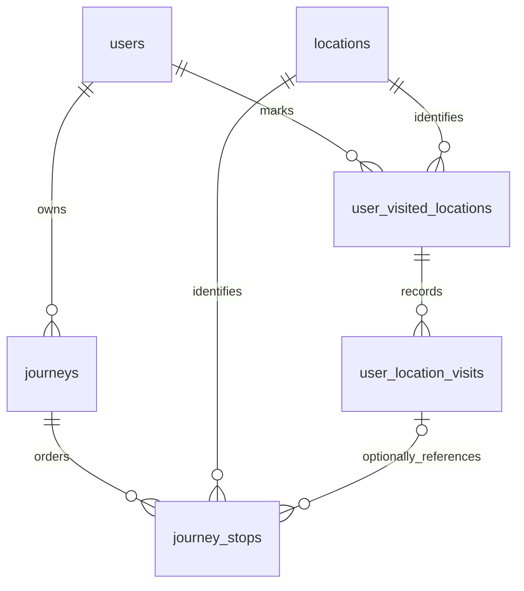

# Phase 2 — Step 1: Database & Architecture

Step 2 đã có implementation API/UI và migration 008; xem [Visited Locations API & UI](phase-2-step-2.md). Tài liệu dưới đây giữ bối cảnh và các quyết định tại Step 1; trạng thái cutover/API mới nhất nằm trong tài liệu Step 2.

Phạm vi: audit, thiết kế dữ liệu, migration bổ sung và kiểm thử constraints trên PostgreSQL/PostGIS. Step 1 chưa mở API Visited/Journey, chưa đổi tab Profile, chưa xuất ảnh hoặc chia sẻ Feed.

## 1. Audit mã nguồn

| Thành phần | File/module hiện hữu | Kết luận / tái sử dụng |
| --- | --- | --- |
| Profile | `frontend/src/app/(main)/profile/[username]/page.tsx`, `components/profile/ProfileTravelMap.tsx`, `ProfileStats.tsx` | Đã có tab Bản đồ của tôi; map chỉ chủ tài khoản xem, lấy visited/wishlist pins. Mở rộng tab này ở Step 3. |
| Pins | `backend/src/users/users.controller.ts`, `users.service.ts`, `frontend/src/lib/api/users.ts` | GET `/users/me/pins`, PUT/DELETE `/users/me/pins/:locationId`; PUT idempotent theo user/location, chưa có ngày, note, visibility hay lịch sử. |
| Map | `frontend/src/components/map/MapCanvas.tsx`, `ClusterLayer.tsx`, `hooks/useMap.ts`, `lib/mapbox/index.ts` | react-map-gl, Supercluster, viewport query, snap/normalize bounds. Tách helpers chuyển dữ liệu/clustering khi cần dùng chung; không gọi `useMap()` lần hai trong component con. |
| Locations | `backend/src/locations/`, `frontend/src/lib/api/locations.ts` | Point 4326, GiST; country/city là text, chưa có mã địa giới chuẩn, chưa có cover image riêng. |
| Posts/Feed | `backend/src/posts/posts.service.ts`, `dto/create-post.dto.ts`, `frontend/src/types/index.ts`, `components/feed/FeedPostCard.tsx`, `components/post/PostCard.tsx` | Bắt buộc location/rating/visited_at; SELECT dùng INNER JOIN locations. Feed đã có lightbox dùng chung. Không suy ra visit từ bài đăng. |
| Itineraries | `backend/src/itineraries/`, `itineraries`, `itinerary_stops` | Kế hoạch theo total_days/day_number/order_in_day; Journey là kỷ niệm có thứ tự, dùng bảng riêng. |
| Media | `backend/src/uploads/`, `frontend/src/lib/api/uploads.ts` | Upload xác thực, Sharp WebP, bỏ metadata, lưu local disk, trả public URL. Dùng lại cho cover/preview sau; chưa có storage ảnh private. |
| Auth/database | `backend/src/common/guards/`, `database/database.service.ts`, `database/migrate.ts` | Tái sử dụng guards, SQL parameters, pool/transaction và runner checksum/advisory lock. |
| Client/contracts | `frontend/src/lib/api/client.ts`, `types/index.ts`, `lib/validations/`, `constants/index.ts` | apiFetch, TanStack Query/QUERY_KEYS và validation hiện có; token trong memory, refresh cookie HttpOnly. Chưa thêm wrapper cho endpoint chưa triển khai. |

Đã đọc AGENTS.md, README root/backend và đối chiếu package/lockfiles. Phiên bản resolved trong frontend lockfile lúc audit: Next.js **15.5.27**, React **19.3.0**, Mapbox GL **3.32.0**, react-map-gl **7.1.9**, Supercluster **8.0.1**, Radix Dialog **1.3.1**. Package.json dùng version ranges; đây không phải xác nhận phiên bản trên production.

Schema trước thay đổi: migrations 001–006; users/profiles/auth_sessions; locations/posts; follows/likes/saves; user_pins; itineraries/itinerary_stops; comments/comment_likes; notifications. UUID và timestamptz là quy ước chung, ngày ghé thăm của posts là date. Trigger duy trì timestamps, counters và notifications. `profiles.country_count` lấy từ pins visited, chưa lọc visibility. Không sửa các migrations/trigger cũ ở Step 1.

## 2. Visited Locations: đánh dấu và lịch sử

Chọn hai lớp dữ liệu:

- `user_visited_locations`: **đánh dấu**, một hàng/user/location; note tối đa 1000, visibility public/private mặc định private, timestamps.
- `user_location_visits`: **lượt ghé thăm**, nhiều hàng thuộc đánh dấu, có ngày visited_at và note. Không biết ngày thì chỉ tạo đánh dấu, không tạo lượt ghé thăm giả.

Phương án A chỉ một hàng/user/location đơn giản nhưng mất lịch sử. Phương án B chỉ lưu các visit hỗ trợ nhiều chuyến nhưng dễ đếm trùng và phải biểu diễn riêng trường hợp không biết ngày. Hai lớp hỗ trợ cả hai: COUNT đánh dấu (hoặc COUNT DISTINCT location_id sau khi lọc visits) là số địa điểm duy nhất; COUNT visits là số ngày ghé thăm đã ghi nhận.

MVP dùng độ chính xác **ngày**: tối đa một visit/địa điểm/ngày. Quay lại ngày khác tạo visit mới; nhiều lượt cùng ngày gộp một visit. Muốn phân biệt giờ/chuyến cùng ngày cần mở rộng schema/API sau. Date phải hữu hạn; không dùng infinity, không tự mặc định ngày hôm nay. Ngày là date, timestamps kỹ thuật là timestamptz, ID là UUID.

UNIQUE `(user_id, location_id)` chống trùng đánh dấu. UNIQUE `(visited_location_id, visited_at)` chống lặp visit cùng ngày. Step 2 dùng upsert cho đánh dấu; conflict visit là replay nếu payload khớp, khác payload trả 409 thay vì ghi đè ngầm. Xóa visit riêng vẫn giữ đánh dấu; xóa đánh dấu xóa mọi visit thuộc nó, cần UX nêu rõ.

User FK tham chiếu users(id); profile vẫn 1:1 với user. Composite FK `(visited_location_id, user_id, location_id)` chống gắn visit vào đánh dấu khác user/location. Index hỗ trợ user/thời gian, public profile và các FK/location lookup. Không thêm geometry.

Visibility nằm ở đánh dấu, visits kế thừa. Chưa hỗ trợ followers. Public API phải lọc visibility và owner active **trước** count, pagination, thống kê, lấy ngày hay markers. Chủ tài khoản xem toàn bộ dữ liệu của mình. Không serialize note/visit ID riêng tư qua Journey public.

### Chuyển đổi pins ở Step 2

Migration 007 không backfill, không đồng bộ ngầm với user_pins, không đọc posts để suy ra visit. Tables mới chưa có writer/API; pins vẫn là nguồn của API/UI hiện tại. Không deploy API mới ghi bảng mới trước khi cutover.

Step 2 phải triển khai đồng thời:

1. Trong cửa sổ chuyển đổi có kiểm soát, chặn/đợi writer pins cũ; migration mới backfill **chỉ pins visited** thành đánh dấu **private**. Giữ thời điểm tạo đánh dấu, không suy ra ngày ghé thăm từ created_at.
2. Đổi UsersService và visited API để có một nguồn sự thật. GET pins giữ shape cũ bằng projection; PUT visited tạo đánh dấu idempotent; DELETE bỏ đánh dấu/lịch sử theo hành vi công bố. Wishlist độc lập, PUT wishlist không được âm thầm xóa lịch sử đã đến.
3. Khi vừa wishlist vừa visited, projection legacy ưu tiên visited. UI mới cần thể hiện hai trạng thái độc lập và kiểm thử thao tác client cũ/mới cùng bản phát hành.
4. Travel stats mới dùng dữ liệu đã lọc theo viewer, không dùng country_count legacy cho public stats. Chỉ thay counter/API cũ cùng code và regression tests. Không suy đoán số tỉnh/quốc gia từ text không chuẩn hóa.

Không chạy backfill riêng rồi để writer cũ tạo drift. Step 1 chưa đổi semantics wishlist/pins hoặc số liệu hồ sơ.

## 3. Journey và Journey Stops



`journeys`: user_id, title (1–200 sau trim), description (tối đa 5000), optional cover_image_url (tối đa 2048), visibility public/private, status draft/published, style_config JSONB, revision, timestamps. Mặc định **private draft**. Người khác chỉ xem khi public **và** published **và** owner active; published private/public draft vẫn chỉ chủ xem.

`journey_stops`: journey_id, user_id, location_id, optional visit_id, stop_order từ 1, location_name_snapshot, optional visited_at_snapshot, created_at. Mỗi địa điểm chỉ một lần/Journey. Composite FK đảm bảo stop cùng owner với Journey; visit nếu có phải cùng owner và location.

Service lấy snapshot tên/ngày từ DB khi tạo/chọn lại stop, không nhận metadata snapshot tự do từ client. Không sao chép note. Sửa/xóa visit không đổi snapshot; ON DELETE SET NULL **chỉ visit_id**, giữ user/location/stop. Xóa đánh dấu không xóa Journey. Location FK dùng RESTRICT, tương tự posts/itinerary, không xóa địa điểm đang tham chiếu.

Journey có vòng đời/quyền riêng tư độc lập: publish là chủ động công khai các điểm/ngày đã chọn, cần preview rõ dữ liệu sắp chia sẻ. Đổi visibility/xóa đánh dấu không tự đổi Journey đã publish; chủ tài khoản quản lý visibility Journey riêng. Public response chỉ chứa snapshot đã chia sẻ, không chứa visit gốc/ghi chú. Step 4 phải kiểm thử luồng publish và quy tắc này. Step 1 chưa mở public endpoint.

Tọa độ luôn lấy từ locations: sửa master geometry làm đổi vị trí trên Journey. Snapshot tên/ngày bảo toàn lịch sử ghé thăm, **không đóng băng geometry**. Không lưu GeoJSON/copy tọa độ. Không tự động công khai dữ liệu mới sau khi sửa visit.

DB kiểm tra trạng thái cuối transaction: thứ tự stops liên tục `1..N`; draft cho phép 0/1 stop; published cần ít nhất 2. UNIQUE `(journey_id, stop_order)` có thể defer để swap/reorder nguyên tử. Deferred constraint triggers cho phép thay toàn bộ danh sách trước commit. BEFORE trigger khóa parent Journey khi ghi stops để serialize với publish/stop writes khác. Service giữ transaction ngắn và thứ tự khóa ổn định khi thao tác nhiều aggregate.

Step 4 dùng DatabaseService.transaction():

1. User từ JWT; khóa Journey FOR UPDATE, kiểm tra ownership và revision client gửi. Revision sai trả 409.
2. Bulk validate các locations/visits thuộc đánh dấu của owner, kể cả stop không có visit_id. Giới hạn số stops ở DTO (đề xuất 100), không N+1.
3. SET CONSTRAINTS journey_stops_order_unique DEFERRED; cập nhật metadata/stops, giữ snapshot cũ khi chỉ reorder, tăng revision một lần cho mutation aggregate.
4. SET CONSTRAINTS ALL IMMEDIATE để bắt lỗi final-state trước khi rời callback; commit rồi mới trả response.

Revision mặc định 1/CHECK dương đã có; compare-and-swap/tăng revision thuộc service Step 4. FK cùng owner bảo vệ **quan hệ**, không thay thế authorization JWT. DB không có auth.uid/RLS; endpoint vẫn phải enforce guards/ownership/visibility.

Style config version 1, mặc định outdoors-v12, đường solid xanh, hiện nhãn/số. DB chỉ yêu cầu JSON object; Step 4 dùng DTO lồng nhau/allowlist: line_color hex, line_style solid/dashed, show_labels/show_order boolean, map_style outdoors-v12 hoặc dark-v11. Reject unknown keys/version và URL style tùy ý. Curved line chưa thuộc MVP. GeoJSON dùng `[lng,lat]`, xử lý antimeridian khi render, không quảng cáo quãng đường/thời gian di chuyển thực tế.

Không đồng nhất Journey với itinerary. Có thể thêm source_itinerary_id nullable bằng migration sau khi có luồng chuyển kế hoạch thành kỷ niệm rõ ràng.

## 4. Posts/Journeys: quyết định cho Step 6

| Lựa chọn | Đánh giá |
| --- | --- |
| Thêm post_type/journey_id vào posts | Tái sử dụng like/comment/save/counters; cần thay post shape có kiểm soát. **Hướng dự kiến cho Step 6.** |
| Bảng post_journeys riêng | Không giải quyết các cột location/rating/visited_at vẫn bắt buộc; thêm join nhưng vẫn phải đổi post shape. |
| Attachment/reference tổng quát | Dự án chưa có abstraction này, vượt nhu cầu MVP. |

Không thêm liên kết posts trong 007: backend/frontend cũ coi location_id/rating/visited_at non-null, Feed INNER JOIN locations. Journey Post lúc này sẽ cần dữ liệu giả hoặc bị rơi khỏi Feed. Step 6 cần migration mới **cùng** controller/DTO/service/query, frontend discriminated union và PostCard:

- post_type mặc định loại bài địa điểm, journey_id nullable. CHECK phân biệt bài thường (đủ location/rating/ngày) với Journey Post (journey_id bắt buộc, không gán location/rating/ngày giả).
- MVP một bài chia sẻ/Journey qua unique reference, retry trả bài cũ. Nếu muốn nhiều bài/Journey, thay bằng request idempotency key và quy tắc rõ ràng.
- Journey/Post cùng owner; chỉ share public published Journey. Share trong transaction, khóa/check revision và visibility.
- Tái sử dụng caption/images và tương tác hiện có, không clone Journey. Mọi đường đọc/count/like/save/comments/notifications phải kiểm tra cả quyền Post **và** Journey. Bao gồm Feed/following, author/location, saved và post-by-id.
- Đổi Journey private/draft phải ẩn Journey Post với người khác ngay. Khi xóa Journey, gỡ bài liên kết trong transaction hoặc RESTRICT và yêu cầu gỡ share trước; không để Post/preview công khai mồ côi.
- Upload hiện trả URL public: đổi private không thu hồi ảnh người khác đã tải. Không upload preview private lên public storage nếu cần bảo mật ảnh; đánh giá authenticated media trước khi làm export/share.

Đây là thiết kế, chưa phải API/schema đã triển khai. Cần đánh giá client đang hoạt động trước khi đổi contract posts.

## 5. Ranh giới triển khai tiếp theo

Đề xuất modules `visited-locations/`, `journeys/`, tái sử dụng DatabaseService. Endpoint dưới `/api/v1`, payload snake_case, không cho body chọn user_id. DTO class-validator/transformer; AccessTokenGuard cho private read/write, OptionalAccessTokenGuard cho public read có viewer. Truy cập không được phép trả 404; revision conflict trả 409.

| Step | Contract dự kiến (chưa triển khai) |
| --- | --- |
| 2 | GET/POST `/users/me/visited-locations`; PATCH/DELETE `/users/me/visited-locations/:id`; POST `/users/me/visited-locations/:id/visits`; PATCH/DELETE `/users/me/visited-locations/:id/visits/:visitId`; GET `/users/:username/visited-locations` |
| 3 | Filter year/search, map data và travel stats cùng điều kiện quyền với list. Aggregate địa điểm duy nhất ở server; không tải toàn bộ lịch sử để lọc ở browser. |
| 4 | GET/POST `/journeys`; GET/PATCH/DELETE `/journeys/:id`; POST `/journeys/:id/publish`. PATCH nhận stops đầy đủ + revision, không reorder bằng nhiều request rời. |

Pagination giữ `{data,count,page,pageSize,hasMore}`, pageSize bị giới hạn bởi DTO; sort ổn định thời gian/id. Filter năm dùng date range trên visits (index user/date), DISTINCT location_id **trước pagination**; đánh dấu chưa có ngày chỉ thuộc all-time. Public count cùng WHERE quyền với data. Query keys chứa viewer/filters tránh dùng cache private cho người khác; invalidate marks/visits/stats/pins liên quan sau mutation.

Step 5 ưu tiên export map riêng bằng source/layer cho route/markers và canvas compositing poster; kiểm tra WebGL lifecycle, fonts/images/CORS và attribution theo tài liệu nhà cung cấp lúc triển khai. Không bật preserveDrawingBuffer cho mọi map. Chưa thêm dependency export/server rendering hoặc đổi cấu hình Mapbox ở Step 1.

## 6. Migration và kiểm thử

Migration: `backend/src/database/migrations/007_travel_map_journeys.sql`. Chỉ CREATE bảng/index/function/trigger mới, dùng set_updated_at hiện có; không sửa dữ liệu/schema pins/posts/itineraries. PostgreSQL **16** + PostGIS theo Docker Compose hiện tại (SET NULL theo cột trên composite FK cần PostgreSQL >=15). Không chạy migration trên database ứng dụng trong quá trình làm Step 1.

Khi triển khai schema, từ backend/:

```bash
npm run db:migrate:status
npm run db:migrate
```

Runner giữ transaction/checksum/advisory lock. Không có env runtime/dependency mới; không cần seed/reset DB. Chạy migration chỉ chuẩn bị nền tảng, chưa kích hoạt Phase 2.

Test tích hợp: `test/travel-map-migrations.db-spec.ts`, `test/jest-db.json`, script test:db. Dùng PostgreSQL/PostGIS **thử nghiệm**, quyền tạo schema/extensions. Ví dụ PowerShell từ backend/ (không commit URL thật):

```powershell
$env:WANDERMAP_TEST_DATABASE_URL = '<connection-string-to-disposable-postgis>'
npm run test:db
```

Không đọc .env/DATABASE_URL ứng dụng; thiếu test URL thì suite được skip rõ ràng. Test tạo schema UUID trong transaction, đặt unaccent ở public theo yêu cầu migration 002, chạy migrations 001–006, seed dữ liệu pins/posts/profile cũ rồi áp dụng 007. Savepoints cô lập ca kiểm thử, SET CONSTRAINTS ALL IMMEDIATE kiểm tra trạng thái trước commit. Cuối cùng rollback cả schema/fixtures và extension được tạo trong transaction. Không DROP/TRUNCATE/reset dữ liệu; ưu tiên container/DB tạm để tránh tải hoặc trùng extension trên DB dùng chung.

Các ca kiểm tra: dữ liệu/write path cũ; đánh dấu không ngày/private; trùng dấu/visit; repeat visits và unique locations; FK owner/location; visibility/text/style shape; publish tối thiểu hai stops; order/duplicate/gap/reorder; snapshot sau sửa/xóa; RESTRICT location; cascade Journey/user. Chưa kiểm thử authorization HTTP, cutover pins, tải lớn, concurrent transactions, export hay UI; thuộc Step 2–7.

File Step 1: migration 007, DB test/config, backend/package.json thêm test:db, README root/backend và tài liệu này. Không đổi migrations 001–006, frontend runtime, auth hay dependency. Tài liệu Phase 1 có sẵn trong workspace được giữ nguyên.

### Kết quả xác minh Step 1

Chạy trên Node 22.21.1, container tạm từ image `postgis/postgis:16-3.5`, không gắn volume database ứng dụng:

| Kiểm tra | Kết quả |
| --- | --- |
| Backend type-check | Pass |
| Lint file test mới | Pass |
| Backend unit tests | 6 suites, 41 tests pass |
| Backend e2e hiện được Jest phát hiện | 1 suite, 1 health test pass (mock DB) |
| Database integration test mới | 15/15 tests pass trên PostGIS thật, có fixtures trước migration 007 |
| Migration runner thật trên DB tạm | Áp dụng 001–007 thành công; status 0 pending; chạy lại không áp dụng trùng/checksum error |
| Backend build | Pass |
| git diff --check | Pass |
| Lint toàn backend | Fail: 6 unused imports sẵn có trong `src/auth/auth.controller.ts` (Get, UseGuards, ApiBearerAuth, AccessTokenGuard, CurrentUser, AuthenticatedUser); không sửa auth ngoài phạm vi |

Chưa chạy frontend type-check/build vì không thay frontend. Không migrate database ứng dụng/production. Chưa triển khai hoặc kiểm thử API/UI Phase 2, cutover pins hay concurrent transactions; các ràng buộc quan hệ dữ liệu đã kiểm thử không thay thế các kiểm tra authorization sau này.
