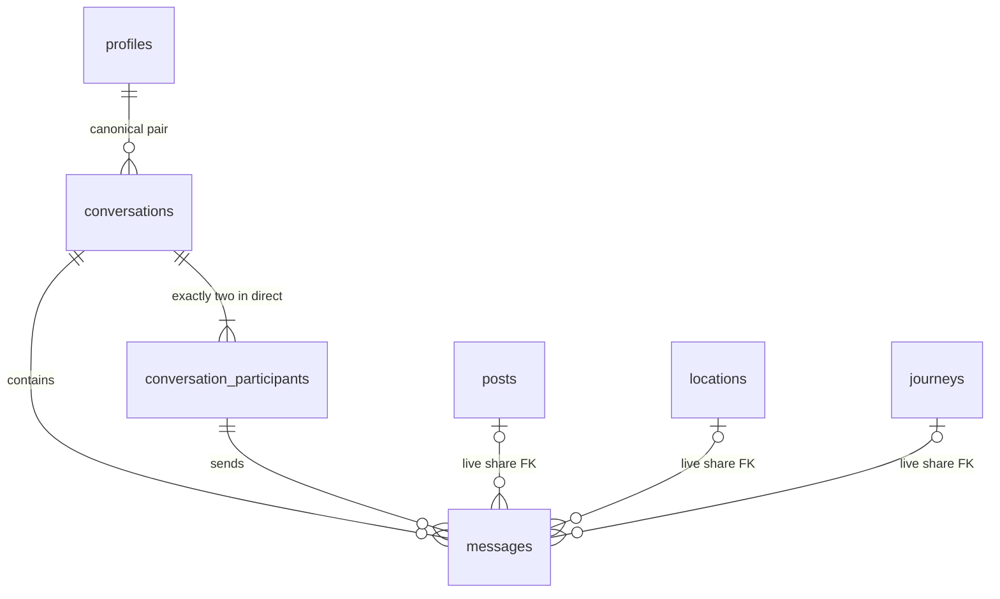

# Phase 4 — Feature 1: Conversations & Messages

## Phạm vi và kết quả khảo sát

Feature 1 chỉ bổ sung schema, ràng buộc dữ liệu và integration tests. Chưa có
Messaging REST API, socket messaging events hoặc UI chat. Không thay đổi migration
001–012, dữ liệu cũ, auth, notifications hay frontend.

Những phần hiện có được tái sử dụng ở các feature tiếp theo:

| Thành phần | Implementation hiện tại / cách sử dụng tiếp |
| --- | --- |
| Database | `DatabaseService.query()` và `transaction()`; `pg`, parameterized SQL; runner checksum/advisory lock/transaction |
| Authentication | `AuthModule`, `AccessTokenGuard`, `AccessTokenService`: JWT HS256, expiration và `users.is_active` |
| Realtime | `RealtimeModule`, `RealtimeGateway`, namespace `/realtime`, room `user:{id}`, fanout nhiều tab/thiết bị; kiểm tra account/token trước private delivery |
| Notifications | Trigger `pg_notify` → dedicated LISTEN connection → enrichment → gateway, chỉ sau commit; giữ nguyên pipeline này |
| Frontend realtime | `AuthProvider` → `useRealtimeConnection`, session registry/singleton socket, cleanup, shared refresh, reconnect/backoff và foreground REST reconciliation |
| Server state | API client với access token trong memory; TanStack Query keys có viewer, cancel/remove cache khi đổi account |
| Shared resources | `PostsModule`/`postAccess()`, `LocationsModule`, `JourneysModule` đã có; Journey hỗ trợ private/public, draft/published và frontend detail |
| UI sau này | MainHeader, ProfileHeaderActions, FeedPostCard/PostCard/PostDetail, location detail, Journey UI; Radix và Sonner đã có, ConfirmDialog có sẵn |

Schema locations hiện không có visibility riêng. Posts/Journeys có policy truy cập
cần áp dụng khi gửi **và** khi đọc preview; quan hệ FK không thay thế authorization.
Chưa thấy block/report domain hoặc endpoint tìm user chung. Các phần này cần được
đánh giá trong Feature 2/sharing, không tự coi follow là block hay quyền nhắn tin.
MVP đề xuất: user đã đăng nhập có thể bắt đầu direct chat với account còn active,
khác chính mình; cần bổ sung policy block tối thiểu trước khi mở messaging thực tế.
Uploads hiện xử lý ảnh qua NestJS/Sharp; Feature 1 không thêm attachments hay upload flow.

## Mô hình dữ liệu



Migration: `backend/src/database/migrations/013_conversations_messages.sql`.

### Conversations và participants

- `conversations`: UUID, `type`, canonical pair `direct_user_low_id`/
  `direct_user_high_id`, timestamps, `last_message_id`, `last_message_at`,
  `message_sequence` (bigint allocation high-water mark).
- BEFORE INSERT chuẩn hóa pair bằng LEAST/GREATEST. CHECK low < high loại self chat;
  unique pair loại cả A–B/B–A, kể cả hai transaction tạo chat đồng thời.
- AFTER INSERT tự tạo hai participants **trong cùng transaction**. Client/service
  không INSERT participants riêng. PK `(conversation_id, user_id)`, guard chỉ chấp
  nhận canonical pair, không cho đổi/xóa một participant, nên direct luôn có đúng hai.
- Participant có `joined_at`, nullable `last_read_sequence`, `last_read_at`,
  `archived_at`. Index `(user_id, conversation_id)` phục vụ danh sách theo viewer.
- Pair/type/identity không thể thay đổi. Phase 4 chỉ chấp nhận `direct`; participants
  nằm ở bảng riêng để có thể mở rộng group bằng migration mới, không triển khai group.

Xóa toàn conversation sẽ cascade messages/participants. Xóa vật lý một profile sẽ
xóa toàn direct conversation có profile đó; đây là policy retention hiện tại của
schema, không phải chỉ ẩn conversation cho một bên. Circular FKs của sender/read/
last-message dùng `DEFERRABLE INITIALLY DEFERRED` để kiểm tra **trạng thái cuối transaction**.
Giữ chế độ deferred trong aggregate writes/cascade; chỉ `SET CONSTRAINTS ALL IMMEDIATE`
khi đã hoàn tất thao tác để kiểm tra trước commit. Vô hiệu hóa account bằng `is_active`
không tự xóa lịch sử; authorization phải từ chối account bị vô hiệu hóa.

### Messages và chia sẻ nội dung

- Message gồm UUID, conversation/sender, `sequence`, `client_message_id`, type,
  content, typed resource FKs và timestamps/soft deletion.
- Composite sender FK `(conversation_id, sender_id)` bảo đảm sender là participant.
- Các type: `text`, `shared_post`, `shared_location`, `shared_journey`.
- Text bắt buộc có nội dung; mọi content không NULL dài 1–4.000 ký tự PostgreSQL
  và không chỉ là whitespace (bao gồm Unicode whitespace theo `String.trim`).
  Shared message cho phép caption hoặc NULL. REST cần chuẩn hóa content nhất quán
  trước khi so sánh idempotency; JS `.length` khác số code points với emoji.
- Shared message nhận `shared_resource_id`. Trigger gán đúng một FK tương ứng
  (`shared_post_id`, `shared_location_id`, `shared_journey_id`); tài nguyên mới gửi
  phải tồn tại. Không nhận/copy tên, ảnh, tọa độ hay private preview JSON từ client.
- `shared_resource_id` giữ nguyên để so sánh retry payload; FK live `ON DELETE SET NULL`
  giữ message sau khi resource bị xóa. Không thể tự xóa live reference của resource
  còn tồn tại. Shared card phải trả unavailable khi FK NULL hoặc viewer mất quyền.
- Identity/request payload bất biến. Cho phép soft delete bằng `deleted_at`, không
  restore hay hard-delete một message riêng lẻ. Last-message có thể trỏ tới tombstone;
  REST/UI phải hiển thị trạng thái đã xóa, không trả nội dung cũ. Soft delete chưa
  phải chính sách purge dữ liệu; retention/purge hoặc edit cần thiết kế migration riêng.

### Ordering và pagination

BEFORE INSERT tăng `conversations.message_sequence` bằng UPDATE row lock và gán
sequence/timestamp do server tạo. Lock giữ tới commit/rollback; một transaction khác
gửi vào cùng conversation phải chờ. Vì vậy một tin commit muộn không thể xuất hiện
ở sequence thấp hơn cursor mà client đã đọc. Chỉ dùng global sequence/identity hoặc
`now()`/UUID không bảo đảm thuộc tính này khi các transaction commit khác thứ tự.

AFTER INSERT cập nhật last-message/time trong cùng transaction. Transaction rollback
khôi phục cả allocation, message và preview. `ON CONFLICT DO NOTHING` có thể chạy
BEFORE INSERT rồi bỏ qua row, để lại khoảng trống allocation; **không dùng sequence
làm message count** và không đòi sequence liên tiếp.

Unique index `(conversation_id, sequence)` hỗ trợ cả hai chiều cursor scan:

```sql
-- Trang đầu bỏ điều kiện sequence; load older dùng cursor độc quyền.
SELECT * FROM messages
WHERE conversation_id = $1 AND sequence < $2::bigint
ORDER BY sequence DESC LIMIT $3;

-- Đồng bộ các tin mới hơn cursor đã biết.
SELECT * FROM messages
WHERE conversation_id = $1 AND sequence > $2::bigint
ORDER BY sequence ASC LIMIT $3;
```

Sequence/read cursor là bigint. `pg` trả decimal string; giữ string trong API/socket/
frontend và so sánh bằng BigInt khi cần, không ép `Number`. Tombstones vẫn có thứ tự.
Index activity `(COALESCE(last_message_at, created_at) DESC, id DESC)` hỗ trợ conversation
list; timestamps bằng nhau dùng UUID làm tie-breaker. Query list cần join membership.

### Idempotency: ràng buộc và protocol cho Feature 2

Unique `(sender_id, client_message_id)` áp dụng toàn bộ conversations của sender;
client tạo UUID một lần và giữ lại khi retry. Payload immutable để retry không đổi
ý nghĩa. Chỉ database constraint chưa tự tạo response HTTP idempotent.

Protocol REST dự kiến, được exercise bằng helper SQL trong integration tests:

1. Lấy sender từ JWT, validate DTO, kiểm tra membership/account/privacy trong transaction.
2. INSERT với `ON CONFLICT ON CONSTRAINT messages_sender_client_unique DO NOTHING RETURNING *`.
3. Nếu không insert, **truy vấn SELECT ở statement kế tiếp** theo sender/key, so sánh
   `conversation_id`, `message_type`, normalized `content`, `shared_resource_id`.
4. Payload trùng trả row cũ (cùng ID/sequence); payload khác trả HTTP 409
   `IDEMPOTENCY_CONFLICT`. Không phát lại message như một message mới khi replay.
5. Commit thành công mới publish event. Publish thất bại không đảo ngược durable write;
   client lấy lại qua REST/retry/reconnect. Không có broker/outbox/durable socket replay.

Không gộp INSERT DO NOTHING + SELECT fallback thành một CTE cùng snapshot: sau khi
đợi transaction đối thủ commit, SELECT của snapshot cũ có thể chưa thấy row thắng.
Tạo direct conversation dùng protocol tương tự với unique pair và SELECT statement
kế tiếp; canonicalization diễn ra trước unique check. Các query đều parameterized.

Ba nguồn optimistic UI/REST/socket ở Feature 4 sẽ merge theo authoritative message ID
và `(sender_id, client_message_id)`, thay pending bubble bằng row server. Event delivery
có thể lặp/đảo thứ tự; sequence quyết định thứ tự hiển thị.

### Read state và unread

`last_read_sequence` là mô hình duy nhất; NULL nghĩa chưa đọc, `last_read_at` chỉ là
thời gian server xác nhận cursor tiến lên. Composite FK `(conversation_id, sequence)`
bảo đảm target thuộc conversation. Guard kiểm tra target tồn tại rồi giữ GREATEST
giữa cursor cũ và mới; retry/stale device không làm cursor hoặc timestamp đi lùi.
PostgreSQL participant row lock tuần tự hóa hai thiết bị cập nhật đồng thời.

API read phải nhận cursor thực sự nhìn thấy (không lấy max server ở thời điểm xử lý),
validate membership và chỉ UPDATE row của JWT viewer. Khi cần nhận message ID, phải
lookup ID **cùng conversation** rồi mới đổi sang sequence. Một cursor chỉ tiến tới
message đã commit; tin commit sau đó có sequence lớn hơn vẫn unread.

```sql
SELECT count(*)::integer AS unread_count
FROM messages m
JOIN conversation_participants cp
  ON cp.conversation_id = m.conversation_id AND cp.user_id = $2
WHERE m.conversation_id = $1
  AND m.sequence > COALESCE(cp.last_read_sequence, 0)
  AND m.sender_id <> cp.user_id AND m.deleted_at IS NULL;
```

Không có unread counter frontend/trigger bổ sung. Read API phải trả cursor/count
authoritative và fanout trạng thái sau commit. UI background tab nhận event không
tự đánh dấu đã đọc.

## Contract dự kiến cho các feature tiếp theo

Các contract dưới đây là thiết kế, **chưa được expose ở Feature 1**. Giữ snake_case
như các resource API hiện tại; `clientMessageId` trong đặc tả tương ứng
`client_message_id` trong JSON/SQL của WanderMap.

| REST `/api/v1` | Dữ liệu/chính sách dự kiến |
| --- | --- |
| `GET /conversations` | Cursor activity + ID, page size giới hạn; other profile, safe last-message, unread |
| `POST /conversations/direct` | `{ recipient_id }`; JWT, active recipient, no self, block/privacy; return existing pair |
| `GET /conversations/:id` | Membership required |
| `GET /conversations/:id/messages` | Membership; `before_sequence`, limit; DTO đồng nhất, tombstone-safe |
| `POST /conversations/:id/messages` | `{ client_message_id, message_type, content?, shared_resource_id? }`; server sender; validation/rate limit/transaction/idempotency |
| `PATCH /conversations/:id/read` | `{ last_read_sequence: "123" }`; chỉ JWT participant, target tồn tại; cursor/count từ DB |

Events dự kiến trên namespace hiện tại:

- `message:new`: message DTO gồm `id`, `conversation_id`, `sender_id`,
  `client_message_id`, `sequence`, `message_type`, safe content/reference và timestamps.
- `message:read`: `conversation_id`, `user_id`, `last_read_sequence`, `last_read_at`;
  unread projection phải tính riêng theo recipient, không dùng chung count cho hai bên.
- `conversation:updated`: conversation identity/invalidation signal; REST quyết định
  viewer-specific preview/unread và quyền đọc resource.

Messaging service/controller chịu nghiệp vụ, queries và transaction. Một event
publisher/transport adapter dùng chung `RealtimeGateway` sau commit; fanout tới
rooms của **hai participants từ database**, gồm tab gửi. Không thêm conversation
rooms hay socket send command trong MVP, không cho client chọn sender/recipient room.
Không dùng events mới qua notification channel/type; không thay pipeline Phase 3.

Risk cần kiểm soát ở Feature 2–4: giữ kiểm tra account/token trước private delivery,
listeners/lifecycle singleton, cleanup cache theo viewer, reconnect reconciliation;
không coi schema FKs là quyền SELECT. Backend dùng role chung và không có RLS;
membership authorization phải nằm trong mỗi REST query/mutation. Chưa có đường đọc
tin nhắn nào được expose trong Feature 1. Không cần dependency/env ứng dụng mới.

## Kiểm thử và triển khai

Từ `backend/`, với database PostgreSQL/PostGIS dùng riêng cho test và tên chứa
`_test`/`test_` (suite có commit thực, không nạp `.env`):

```powershell
$env:WANDERMAP_TEST_DATABASE_URL = '<disposable-postgis-connection-string>'
npm run test:db -- --runTestsByPath test/messaging-migrations.db-spec.ts
npm run test:db
npm run type-check
npm run lint
npm test -- --runInBand
npm run test:e2e -- --runInBand
npm run build
```

Suite migration tạo schema UUID riêng, chạy 001–012 và fixtures cũ trước 013,
kiểm tra constraints, resource deletion, cursor/Unicode, soft deletion, unread,
rollback và nhiều connections cùng ghi/read/khởi tạo conversation; cleanup chỉ
schema tự tạo. Thiếu URL test thì suite skip, không được coi là đã test PostgreSQL.
Các helper replay/409 trong suite chỉ chứng minh protocol SQL, không phải REST API.

Khi triển khai, chạy `npm run db:migrate` trong `backend/`, rồi
`npm run db:migrate:status`. Migration chỉ tạo bảng/index/functions/triggers mới,
không backfill hoặc sửa dữ liệu cũ. Runner bảo vệ transaction/checksum như trước.
Không reset volume, không sửa migration đã áp dụng. Feature 1 không đòi cấu hình
Socket.IO/frontend mới; kiểm thử hai tài khoản/hai trình duyệt chờ Feature 2–4.

File thêm: migration 013, `backend/test/messaging-migrations.db-spec.ts`, tài liệu này.
`backend/README.md` chỉ bổ sung liên kết tới hướng dẫn Feature 1.

### Kết quả xác minh ngày 23/10/2026

Đã chạy trên Node 22.21.1, PostgreSQL 16/PostGIS 3.5 trong container test riêng,
bind loopback, không dùng volume hay database ứng dụng:

| Kiểm tra | Kết quả |
| --- | --- |
| `npm run type-check` | PASS |
| `npm run lint` | PASS |
| `npm run build` | PASS |
| `npm test -- --runInBand` | PASS: 10 suites, 144 tests |
| `npm run test:e2e -- --runInBand` | PASS: 1 health test (database check mock, không phải messaging e2e) |
| `npm run test:db` | 4/5 suites PASS, 75 tests PASS / 18 FAIL; 33 tests mới của Feature 1 đều PASS |
| Migration runner trên DB test | 001–013 áp dụng thành công; status 0 pending; chạy migrate lần hai không thay đổi schema |

18 failures nằm trong `test/visited-locations-api.db-spec.ts`: JWT fixture ký không
có `exp` nhưng `AccessTokenService.verify()` hiện bắt buộc expiration, nên các
request cần auth trả 401. Suite đó chỉ nạp migrations đến 008, không chạy 013.
Không sửa fixture/auth trong Feature 1; đây là lỗi test cũ cần xử lý riêng.
Các DB suites Journey posts, realtime notifications, travel-map migrations và
messaging đều PASS. Database ứng dụng chưa được áp dụng migration 013 trong lần này.
Không chạy frontend checks vì không có thay đổi frontend.
