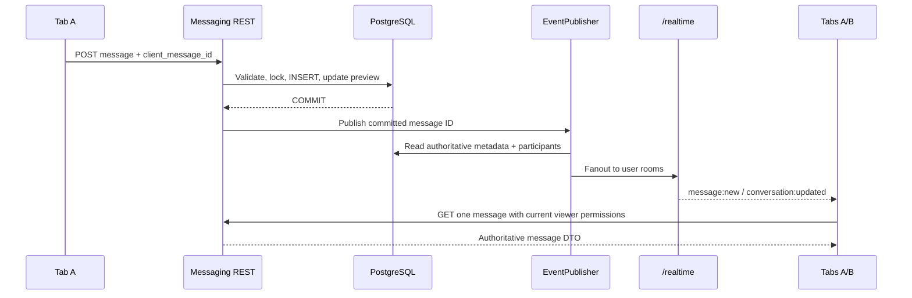

# Phase 4 — Feature 3: Socket.IO Integration

## Kiến trúc và phạm vi

Messaging dùng **cùng** `RealtimeModule`, gateway, HTTP server, namespace `/realtime`,
path `/socket.io`, JWT handshake, user rooms và frontend singleton Manager của Phase 3.
REST vẫn là đường tạo tin duy nhất. Gateway không có socket send/join/read commands,
không chứa lịch sử chat, SQL hoặc nghiệp vụ messaging.



`MessagingEventPublisher` chỉ nhận server-side IDs sau khi
`DatabaseService.transaction()` resolve. Nó truy vấn participants/account từ DB,
không tin recipient hay room do client gửi. Gateway kiểm tra account active và JWT
expiration tại private delivery, kể cả khi expiry timer bị chậm; gửi đến tất cả
connections của hai participants, bao gồm tab gửi. Không thêm conversation rooms.

Lỗi enrichment/transport được cô lập sau commit: REST vẫn trả message đã lưu,
người còn lại vẫn có thể nhận event, retry trả cùng ID với created=false. Log chỉ
có thông báo lỗi vận chuyển tổng quát, không ghi nội dung chat/token.

## Event contract

Payload snake_case. Mỗi payload có `event_id`, `conversation_id`, `recipient_id`.
IDs là UUID, sequence là decimal string bigint, timestamps do server tạo.

| Event | Trường bổ sung | Khi nào phát |
| --- | --- | --- |
| `message:new` | `message_id`, `sender_id`, `client_message_id`, `message_type`, `sequence`, `created_at` | Message mới đã commit |
| `message:read` | `user_id`, `last_read_sequence`, `last_read_at` | Read cursor thực sự tiến lên và đã commit |
| `conversation:updated` | `reason`: created/message/read/policy; `message_id` (chỉ có giá trị với reason message) | Tạo chat, tin mới, read tiến lên, block/unblock thay đổi |

`message_id` là safe content reference, resolve qua REST ở endpoint bên dưới.
Event **không chứa** content, shared-resource UUID, ảnh/caption preview, profile
record, unread count, access token hay refresh cookie. Do đó resource đổi private
giữa commit và publication không làm lộ preview từ snapshot cũ. REST đọc lại
projection theo quyền viewer hiện tại; sender và recipient có thể nhận DTO khác nhau.

Message dùng `event_id=message_id`; cặp message:new/conversation:updated dùng chung
ID nhưng phân biệt bằng event name. Read/policy/create dùng UUID mới cho một lần
publication; các participant nhận cùng ID, recipient_id riêng theo room.
Không giả định thứ tự publication giống thứ tự commit: sequence quyết định message
ordering, REST quyết định read cursor/unread. Không cộng/trừ unread từ socket payload.

Không phát lại khi gửi retry thành công, conflict, transaction rollback, read cursor
không đổi/đi lùi hoặc block/unblock không đổi trạng thái. Read publisher đọc cursor
mới nhất từ DB; event đến chậm có thể báo cursor cao hơn request ban đầu.

## REST bổ sung

`GET /api/v1/conversations/:id/messages/:messageId`

- JWT/account active và conversation membership, cùng policy với history.
- Message phải thuộc đúng conversation trong URL; outsider/missing trả 404.
- Trả cùng message DTO như REST send/history; `Cache-Control: private, no-store`.
- Soft-deleted message giữ tombstone identity/cursor, content và shared_resource NULL.
- Shared resource không còn truy cập được trả available=false và bỏ toàn bộ preview.

Frontend wrapper: `getConversationMessage(conversationId, messageId, signal)` dùng
`apiFetch`, shared refresh cookie và token memory hiện có. Không thêm HTTP client.

## Cache và reconnect synchronization

`useRealtimeConnection` sở hữu một `createMessagingSync` bên cạnh notification sync
trong effect lease/QueryClient hiện có. Lifecycle đăng ký ba messaging listeners;
token refresh, logout, owner switch và disposal dọn listeners theo socket version.
Không tạo thêm Socket.IO connection cho chat.

`frontend/src/lib/realtime/messaging.ts` thực hiện:

1. Parse/allowlist metadata, kiểm tra UUID/date/bigint và recipient đúng owner.
2. Dedup event name/ID với TTL 60 giây, tối đa 512 entries; batch 100 ms.
3. Refetch list/unread/conversation detail đang active qua REST. Inactive queries
   chỉ stale. Read/policy events không refetch message history, không mark read.
4. Với message hint, gộp message IDs từ cả hai event vào Set. Với history đang active,
   cancel snapshot cũ đang fetch, GET riêng message mới (tối đa 4 requests đồng thời
   trong một conversation), rồi merge vào cache. Không refetch các trang lịch sử
   chỉ vì một tin mới đến. Conversation:updated có message_id cũng tự khôi phục tin
   nếu message:new đi kèm bị thiếu.
5. Nếu initial history còn pending/chưa có data, cancel snapshot cũ và refetch query
   hiện tại để response trước event không che mất tin mới. Inactive history stale
   để khi mở lại tải REST mới, không fetch nền từng message.
6. Khi reconnect/foreground/online: cancel rồi invalidate prefix
   `QUERY_KEYS.messaging.viewer(viewer)`, refetch active queries và các trang infinite
   đã mở, giữ pageParams. Không tải toàn bộ lịch sử DB trong một request.
7. Logout/đổi account: abort message resolution, tăng generation, clear queue/dedup,
   cancel/remove toàn bộ private messaging queries. Response cũ không tạo lại cache;
   owner mới có thể reconcile ngay cả khi request cũ chưa kết thúc.

Queue quá 64 conversations hoặc 256 message IDs chuyển sang full REST reconciliation
của active queries. Lỗi mạng để history stale, lần reconnect/foreground tiếp theo
thử lại. REST 404 khi resolve message xóa stale history/detail của conversation đó.

`reconcileMessageCache` dùng chung cho event resolution và REST/optimistic reconciliation
ở UI tiếp theo: match authoritative message ID **hoặc** `(sender_id, client_message_id)`,
loại các copy trùng giữa pages, so sánh sequence bằng BigInt, giữ page boundaries/
pageParams/cursor. Event trễ nằm ngoài vùng older đã tải không tạo khoảng trống giả.

Feature 4 phải dùng đúng các keys `messages(viewer, conversation)` và
`conversations(viewer)`, truyền AbortSignal tới API queries, tích hợp helper khi
đối soát optimistic state, giữ draft/scroll và chỉ mark read khi UI thực sự hiển thị.
Feature 3 chưa tạo trang/chat composer hay optimistic bubble UI. Background tab nhận
event chỉ đồng bộ cache/unread, không tự gọi read API.

## Delivery và triển khai

- Không có migration, dependency hay biến môi trường mới. Database cần migrations
  001–014 từ Feature 2. Không sửa auth/cookie/CORS hoặc notification LISTEN/NOTIFY.
- Cấu hình `NEXT_PUBLIC_REALTIME_URL`, origin allowlist, reverse proxy WebSocket
  upgrade và path `/socket.io` giữ như Phase 3. Fanout notifications vẫn hoạt động
  khi MessagingModule dùng cùng gateway.
- Messaging publication là best effort trong API process hiện tại. Không có durable
  outbox/replay/ack guarantee; crash sau commit trước emit vẫn giữ dữ liệu DB và được
  REST reconciliation khôi phục. Nếu socket khỏe nhưng một event bị mất do lỗi publish,
  dữ liệu có thể chậm tới lần REST reconciliation tiếp theo.
- User-room fanout hiện giới hạn một API process. Scale nhiều instances cần thiết kế
  adapter/event distribution có chủ đích; không tự thêm Redis/Kafka hay server khác.
- Typing/presence, group chat và UI chưa nằm trong Feature 3. Không có nội dung chat
  trong gateway memory hoặc BroadcastChannel.

## Kiểm thử

Từ `backend/`, chỉ dùng disposable PostgreSQL/PostGIS với tên chứa `_test`/`test_`:

```powershell
$env:WANDERMAP_TEST_DATABASE_URL = '<disposable-postgis-connection-string>'
npm run test:db -- --runTestsByPath test/messaging-realtime.db-spec.ts
npm run test:db
npm run type-check
npm run lint
npm test -- --runInBand
npm run build
npm run test:e2e -- --runInBand
```

Từ `frontend/`:

```powershell
node --experimental-transform-types --test tests/*.test.mjs
npm run type-check
npm run build
```

`messaging-realtime.db-spec.ts` chạy REST, JWT, transaction, gateway và Socket.IO
clients thật trên PostGIS; mô phỏng hai tab A, hai tab B và một outsider. Kiểm tra
commit/rollback gate, message/read fanout, concurrent retry, policy changes, forged
socket commands, targeted REST membership, privacy change trước publication,
publisher/transport failure, token expiry, inactive recipient, offline recovery và
backend restart. Test restart drop transport rồi khởi động API lại cùng port/DB.

`realtime-messaging.test.mjs` dùng TanStack Query/observers thật để kiểm tra targeted
fetch, multi-tab caches, REST-authoritative unread/read, giữ older pages, bigint order,
cancel response cũ, owner switch/dispose, queue bounds và shared auth lifecycle.
Các tests singleton Manager/session lease của Phase 3 tiếp tục chạy.

Các tab trong integration test là Socket.IO clients độc lập, chưa phải browser/UI
e2e chat; kiểm thử thao tác trên hai trình duyệt và scroll/draft chờ Feature 4.

### Kết quả xác minh ngày 23/10/2026

Chạy trên Node 22.21.1, PostgreSQL 16/PostGIS 3.5 trong container test riêng, không
dùng database/volume ứng dụng:

| Kiểm tra | Kết quả |
| --- | --- |
| Socket.IO + REST + PostGIS tests mới | PASS: 13/13 |
| Toàn bộ `npm run test:db` | PASS: 7 suites, 136/136 tests |
| Backend type-check/lint/build | PASS |
| Backend unit/gateway tests | PASS: 10 suites, 144 tests |
| Backend e2e health | PASS: 1 test, database check mock |
| Frontend messaging sync/cache tests mới | PASS: 16/16 |
| Toàn bộ frontend tests | PASS: 92/92 |
| Frontend type-check/build | PASS; warnings cũ ở MapTopbar, PostFeedClient, useDebounce, lib/mapbox |

Đã sửa REST test harness để giữ HTTP server listening suốt suite; lần chạy lại toàn
bộ DB tests với `--trace-warnings` không còn cảnh báo `MaxListenersExceededWarning`.
Không tăng giới hạn listeners hay bỏ assertions. Notification pipeline Phase 3,
REST API Feature 2 và các DB suites trước đó đều PASS. Không phát sinh migration
hoặc thay đổi database ứng dụng trong Feature 3.

## Files

- Backend thêm `messaging-events.ts`, `messaging-events.publisher.ts` và
  `test/messaging-realtime.db-spec.ts`.
- Backend sửa messaging module/service/policy/controller, transport gateway và
  REST test harness (listen một HTTP server suốt suite khi gateway được tích hợp).
- Frontend thêm `lib/realtime/messaging.ts`, `tests/realtime-messaging.test.mjs`;
  sửa lifecycle/useRealtimeConnection, API wrapper và query keys.
- `backend/README.md` thêm liên kết tới tài liệu này.
